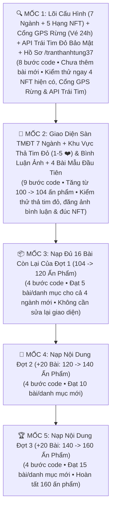

# LỘ TRÌNH CODE & KIỂM THỬ CHI TIẾT TỪNG BƯỚC (5 MỐC MICRO-CHECKPOINTS)
**Dự án:** Hệ sinh thái Yêu Trồng Cây (`https://yeutrongcay.com`)  
**Mục tiêu:**
1. Mở rộng giao diện Sàn TMĐT Sinh thái **7 Danh mục (160 Ấn phẩm)** & Hệ thống **5 Hạng mục Tài sản Số NFT** theo kiến trúc "Plug-and-Play" (`ecosystemRegistry.ts`).
2. Tích hợp **Danh mục thứ 7 (`🌲 Rừng & Khu Sinh Thái`)** với cơ chế **`1 NFT = 10.000 m²` (`1 ha`): cứ chứng minh GPS đang ở trong bán kính khu vực rừng đó (`d <= radius_km`, hỗ trợ Vé Check-in GPS 24h chống mất sóng 4G rừng sâu) là được đúc 1 Lô `10.000 m²` kế tiếp (`#1, #2...`), đúc hết diện tích khu rừng thì ngừng mint**.
3. Tích hợp **Hệ thống Đánh giá "1 đến 5 Trái Tim Đỏ (`❤️❤️❤️❤️❤️`)" & Bình luận Đính kèm Hình ảnh Siêu Nhẹ** (Batch Summary Cache `O(1)`, tự động nén ảnh `.webp` `~50–90 KB/ảnh`, chặn tuyệt đối video, khóa bảo mật `.htaccess` và chống spam Rate Limit).

**Nguyên tắc thực thi:** Xong mỗi Mốc (Checkpoint) đều chạy `npm run build`, xóa sạch `dist/`, đẩy lên Plesk và kiểm thử trực tiếp trên `yeutrongcay.com` đạt 100% trước khi chuyển sang Mốc tiếp theo.

---

## 🗺️ SƠ ĐỒ TỔNG QUAN 5 MỐC THỰC THI



---

## 🔍 MỐC 1 (CHECKPOINT 1): TẦNG LÕI PLUG-AND-PLAY + CỔNG GPS KHU VỰC RỪNG (`10.000M²/NFT`) + API ĐÁNH GIÁ TRÁI TIM ĐỎ BẢO MẬT + HỒ SƠ `/tranthanhtung37`
> **Mục tiêu Mốc 1:** Xây dựng xong file cấu hình trung tâm `src/config/ecosystemRegistry.ts` (7 danh mục + 5 hạng NFT), tích hợp kiểm tra bán kính khu vực rừng (`d <= radius_km` kèm Vé Check-in GPS 24h) cho hạng `geo_forest_10000m2`, tạo API & Service **Đánh giá 1–5 Trái Tim Đỏ kèm nén ảnh WebP siêu nhẹ (`api/reviews.php` + `plantReviewService.ts`)**, vá kín lỗ hổng bảo mật trên `api/passports.php` & `public/.htaccess`, và nâng cấp trang Hồ sơ cá nhân (`https://yeutrongcay.com/tranthanhtung37`) cùng Phòng đúc Web3 (`/web3-sandbox`).

### Danh sách 8 Bước Code của Mốc 1:

- [ ] **Bước 1.1 – Mở rộng Kiểu Dữ Liệu Hệ Thống (`src/types/index.ts`, `src/data/collections.ts`)**:
  - Mở rộng `PlantCategory` lên 7 danh mục trong `src/types/index.ts` và cập nhật `SubCategory.category: PlantCategory` trong `src/data/collections.ts`:
    ```ts
    export type PlantCategory = 'herb' | 'fruit' | 'ornamental' | 'space' | 'recycle' | 'culinary' | 'forest';
    ```
  - Thêm kiểu phân hạng Tài sản Số NFT (5 hạng):
    ```ts
    export type NftAssetClass = 'botanical' | 'space_method' | 'eco_invention' | 'culinary_recipe' | 'geo_forest_10000m2';
    ```
  - Thêm cấu trúc thông số khu vực rừng `ForestGeoSpec` (`total_area_m2`, `unit_area_m2: 10000`, `max_nft_supply`, `center_lat`, `center_lng`, `radius_km`, `province`, `unesco_or_status`).
  - Thêm cấu trúc **Đánh giá Trái Tim Đỏ & Bình luận Hình ảnh**:
    ```ts
    export interface PlantHeartReview {
      id: string;
      plant_slug: string;
      author_name: string;
      author_handle?: string;
      author_wallet?: string;
      is_nft_owner?: boolean;      // Được xác thực chéo với sổ cái NFT trên Server
      hearts: 1 | 2 | 3 | 4 | 5;   // Thang điểm 1 đến 5 Trái Tim Đỏ ❤️
      context_tag?: string;        // Thẻ ngữ cảnh thực tế (VD: 'Sân thượng', 'Ban công', 'Đã làm thử', 'Tại rừng')
      comment: string;
      image_urls: string[];        // Tối đa 2 ảnh tĩnh đã nén WebP (Cấm tuyệt đối video)
      created_at: string;
    }

    export interface PlantHeartSummary {
      average_hearts: number;      // VD: 4.9
      total_reviews: number;       // Tổng lượt thả tim / bình luận
      photo_count: number;         // Số bình luận có đính kèm ảnh
    }
    ```

- [ ] **Bước 1.2 – Tạo Sổ Đăng Ký Cấu Hình Trung Tâm (`src/config/ecosystemRegistry.ts`) [FILE MỚI] & Đồng bộ Type-Safe cho `CategoryPage.tsx` / `HomePage.tsx`**:
  - Khai báo `ECOSYSTEM_CATEGORIES` (**7 danh mục**: `herb`, `fruit`, `ornamental`, `space`, `recycle`, `culinary`, `forest`) và `NFT_ASSET_CLASSES` (**5 hạng NFT**: `botanical`, `space_method`, `eco_invention`, `culinary_recipe`, `geo_forest_10000m2`).
  - Viết các hàm helper dùng chung toàn hệ thống:
    - `calculateHaversineDistanceKm(lat1, lng1, lat2, lng2)`: Kiểm tra người dùng có đang nằm trong bán kính khu vực rừng (`d <= radius_km`) hay không.
    - `saveForestGpsCheckinPass(slug, lat, lng, distanceKm)` & `getValidForestGpsCheckinPass(slug)`: Lưu tạm Chứng thực GPS hợp lệ trong **24 giờ** để hỗ trợ du khách khi ở giữa rừng sóng 4G yếu vẫn có thể ký ví MetaMask ngay khi có mạng.
    - `getCategoryConfig`, `getNftClassConfig`, `resolvePlantNftClass`, `inferNftClassFromPassport`, `isBotanicalSpecies`, `interleaveMarketplaceItems` (trộn xen kẽ vòng tròn 7 danh mục).
  - Cập nhật `categoryInfoMap` trong `HomePage.tsx` và `meta` trong `CategoryPage.tsx` đọc từ `getCategoryConfig` để trình biên dịch `tsc` (TypeScript Strict Mode) pass 100% ngay ở Mốc 1.

- [ ] **Bước 1.3 – Gia cố Bảo mật Server API (`api/passports.php`, `api/plants.php`, `public/.htaccess`) & Tạo Mới `api/reviews.php` [FILE MỚI]**:
  - Trên `public/.htaccess`: Chặn truy cập trực tiếp từ trình duyệt vào các file lưu trữ `*_store.json` (`(\.env|\.sql|\.jsonl|_store\.json|config\.php)$`).
  - Trên `api/passports.php`: Giới hạn payload `512 KB`, khóa bất biến chủ sở hữu gốc (`Write-Once Immutability`), khóa sửa hồ sơ 1/1 ở phía Server (`has_edited_once`), lưu `forest_slug` và `lot_number`.
  - Trên `api/plants.php`: Mở rộng 7 `category` hợp lệ và nâng `LIMIT 100` lên `LIMIT 500`.
  - **Tạo mới `api/reviews.php` (Hệ thống Lưu trữ Trái Tim Đỏ & Ảnh Bình Luận Bảo Mật 4 Lớp)**:
    1. Endpoint `GET /api/reviews.php?action=summaries` trả về tổng hợp toàn bộ bài viết trong 1 request nhẹ (`~3 KB`) chống lỗi `N+1 HTTP Requests`.
    2. Tự động sinh file **`uploads/reviews/.htaccess`** tắt hoàn toàn PHP Engine (`php_flag engine off`, `RemoveHandler .php .phtml .phar`) để chống thực thi mã độc 100%.
    3. Kiểm tra chữ ký ảnh thực tế bằng `getimagesizefromstring()`, **chặn tuyệt đối mọi định dạng Video (`.mp4`, `.mov`, `.webm`...) hoặc file lạ**; vẽ lại ảnh sạch qua `GD` (nếu có) để xóa EXIF ẩn; giới hạn dung lượng mỗi ảnh `<= 250 KB`, đặt tên file ngẫu nhiên an toàn `rev_<slug>_<timestamp>_<rand>.webp`.
    4. **Chống Spam & Xác thực Chủ NFT**: Rate Limit tối đa 5 bình luận / 10 phút / IP; lọc `strip_tags`; tự động đối chiếu `author_wallet` / `author_handle` với `nft_registry_store.json` để gắn cờ `is_nft_owner = true` chính xác; hỗ trợ Quản trị viên (`@tranthanhtung37`) xóa bình luận rác kèm xóa file ảnh vật lý.

- [ ] **Bước 1.4 – Tạo Dịch vụ Đánh Giá Trái Tim Đỏ & Nén Ảnh WebP Tự Động (`src/services/plantReviewService.ts`) [FILE MỚI]**:
  - Cơ chế **Singleton Batch Summary Cache**: Gọi 1 lần duy nhất `fetchAllReviewSummaries()` khi mở trang để mọi thẻ `PlantCard` đọc điểm Trái Tim Đỏ tức thì (`O(1)`).
  - Hàm **`compressImageToWebP(file: File)`**:
    - Chặn ngay nếu `file.type` là `video/*` hoặc không phải ảnh tĩnh (`JPG/PNG/WebP`).
    - Dùng `HTML5 Canvas` thu nhỏ cạnh lớn nhất về `<= 1024px` và xuất ra `data:image/webp;base64` (`quality = 0.78`), trả về cả `dataUrl` và `sizeKB` (`~50–90 KB`) để hiển thị cho người dùng.

- [ ] **Bước 1.5 – Nâng cấp Dịch vụ Sổ Cái NFT & Bộ Đếm Lô `10.000 m²` Xác Định (`src/services/plantPassportRegistryService.ts`)**:
  - Với 4 hạng đầu: Độc bản `1/1` theo từng bài viết.
  - **Với hạng thứ 5 (`geo_forest_10000m2`)**:
    - Khóa định danh theo **Số thứ tự Lô `10.000 m²` của khu rừng (`geoforest10k_<slug>_lot_<N>`)**.
    - Sắp xếp tất cả NFT của khu rừng theo `Number(token_id)` tăng dần trên Blockchain (`Deterministic On-Chain Lot Ordering`) để tính chính xác `getForestMintedAreaStats(forestSlug, totalAreaM2)` và khóa ngừng mint khi `mintedCount >= max_nft_supply`.

- [ ] **Bước 1.6 – Nâng cấp Trang Hồ Sơ Công Khai (`src/pages/PublicProfilePage.tsx`) & Kho NFT (`src/components/BotanicalNftGallery.tsx`)**:
  - Hiển thị thống kê cơ cấu **5 hạng mục NFT** (`🌱 Thực vật • 📐 Không gian • ♻️ Sáng chế • 🍵 Bí phương • 🌲 X Lô Rừng (X0.000 m²)`) và **Thanh Tab Lọc Nhanh 5 Hạng NFT**.

- [ ] **Bước 1.7 – Nâng cấp Phòng Đúc NFT & Cổng Xác Thực Khu Vực Rừng (`src/components/Web3SandboxSection.tsx`)**:
  - Khi chọn hạng `geo_forest_10000m2`, bắt buộc bấm **"📍 Xác Thực Đang Ở Trong Khu Vực Rừng"** (`d <= radius_km`, hỗ trợ lưu Vé Check-in GPS 24h) mới mở khóa đúc Lô `10.000 m²` kế tiếp.

- [ ] **Bước 1.8 – Build, Dọn dẹp `dist/` & Đồng bộ Mốc 1 lên Plesk**.

---

## 🧪 MỐC 2 (CHECKPOINT 2): GIAO DIỆN SÀN TMĐT 7 NGÀNH HÀNG + THẢ TIM ĐỎ (`1–5 ❤️`) & BÌNH LUẬN ẢNH + 4 BÀI MẪU ĐẦU TIÊN (`100` $\rightarrow$ `104` ẤN PHẨM)
> **Mục tiêu Mốc 2:** Đưa giao diện 7 danh mục lên Trang chủ, tích hợp **Huy hiệu Trái Tim Đỏ trên thẻ `PlantCard`**, tích hợp **Khu vực Đánh giá 1–5 Trái Tim Đỏ & Bình luận Hình ảnh (`PlantHeartReviewSection.tsx`)** vào Trang chi tiết bài viết, và nạp 4 bài mẫu đầu tiên (`space-01`, `recycle-01`, `culinary-01`, `forest-01`).

### Danh sách 9 Bước Code của Mốc 2:

- [x] **Bước 2.1 – Bổ sung 12 Tiểu Nhóm Mới (`src/data/collections.ts`)** [HOÀN THÀNH].
- [x] **Bước 2.2 – Nâng cấp Thẻ Sản Phẩm (`src/components/PlantCard.tsx`)**:
  - 7 màu Badge danh mục + nút Đúc NFT theo 5 hạng (thẻ Rừng hiển thị `🌲 Đã đúc: X / Tổng Lô 10.000m²`).
  - **Hiển thị Huy hiệu Trái Tim Đỏ (`❤️ 4.9 (X)`)** đọc từ Batch Summary Cache `O(1)` ngay trên thẻ bài viết. [HOÀN THÀNH]
- [x] **Bước 2.3 – Tạo Component Đánh Giá 1–5 Trái Tim Đỏ & Bình Luận Hình Ảnh (`src/components/PlantHeartReviewSection.tsx`) [FILE MỚI]**:
  - Bộ chọn **1 đến 5 Trái Tim Màu Đỏ (`❤️`) cỡ lớn `36x36px`** kèm hiệu ứng nhịp đập và nhãn cảm xúc.
  - Chọn nhanh **Thẻ Ngữ Cảnh Thực Tế 1 chạm** (`☀️ Sân thượng`, `🏢 Ban công chung cư`, `🛋️ Trong nhà`, `🍵 Đã làm thử`, `🥾 Đã đến thực địa`).
  - Đính kèm tối đa 2 bức ảnh (hiển thị huy hiệu **`⚡ Đã tối ưu WebP: XX KB`**, chặn 100% video) + **Image Lightbox** phóng to ảnh bình luận + Huy hiệu **`🛡️ Chủ Sở Hữu NFT Độc Bản`**. [HOÀN THÀNH]
- [x] **Bước 2.4 – Nâng cấp Bộ Lọc Sidebar (`src/components/PlantFilterBar.tsx`) & Banner (`src/components/Hero.tsx`)** [HOÀN THÀNH].
- [x] **Bước 2.5 – Nâng cấp Trang Chủ Sàn TMĐT (`src/pages/HomePage.tsx`)**: Mặc định `all`, trộn xen kẽ 7 ngành hàng (**Smart Marketplace Interleaving**), thêm **Thanh Kệ Hàng Ngang 1 Chạm** và nút lọc nhanh **`❤️ Được yêu thích nhất`** [HOÀN THÀNH].
- [x] **Bước 2.6 – Nâng cấp Trang Chi Tiết Bài Viết Đa Hình (`src/pages/PlantDetailPage.tsx`)**:
  - Đổi nhãn thông số tự động theo 7 danh mục + Bảng Quỹ Diện Tích `10.000 m²/NFT` cho danh mục `forest`.
  - Hiển thị dải Trái Tim Đỏ ngay dưới tiêu đề bài viết và nhúng `PlantHeartReviewSection` ở cuối bài viết [HOÀN THÀNH].
- [x] **Bước 2.7 – Cập nhật Tìm Kiếm (`src/components/Navbar.tsx`, `src/utils/searchUtils.ts`) & Lọc Cây Sống Vườn Số (`src/pages/GardenPage.tsx`, `src/components/MyGardenModal.tsx`)** [HOÀN THÀNH].
- [x] **Bước 2.8 – Nạp 4 Bài Mẫu Đại Diện Đầu Tiên (`space-01`, `recycle-01`, `culinary-01`, `forest-01` – *VQG Cúc Phương: 224.080.000 m² = 22.408 Lô NFT*) vào `src/data/plants.ts`, `src/i18n/plantTranslations.ts` & đồng bộ `api/plants_data.json` (cho Sitemap & OpenGraph Zalo/FB)** [HOÀN THÀNH].
- [x] **Bước 2.9 – Build, Dọn dẹp `dist/` & Đồng bộ Mốc 2 lên Plesk (`104` ấn phẩm)** [HOÀN THÀNH].

---

## 📦 MỐC 3 (CHECKPOINT 3): HOÀN TẤT NỘI DUNG ĐỢT 1 (+16 BÀI: `104` $\rightarrow$ `120` ẤN PHẨM)
- [ ] **Bước 3.1 – 3.4**: Bổ sung đủ 16 bài còn lại của Đợt 1 (`space-02..05`, `recycle-02..05`, `culinary-02..05`, `forest-02..05`), đồng bộ `api/plants_data.json`, Build, xóa `dist/` & Deploy (**120 ấn phẩm**).

---

## 🌿 MỐC 4 (CHECKPOINT 4): NẠP NỘI DUNG ĐỢT 2 (+20 BÀI: `120` $\rightarrow$ `140` ẤN PHẨM)
- [ ] **Bước 4.1 – 4.4**: Bổ sung 20 bài Đợt 2 (`06..10` cho cả 4 ngành mới), đồng bộ `api/plants_data.json`, Build, xóa `dist/` & Deploy (**140 ấn phẩm**).

---

## 🏆 MỐC 5 (CHECKPOINT 5): NẠP NỘI DUNG ĐỢT 3 (+20 BÀI: `140` $\rightarrow$ `160` ẤN PHẨM)
- [ ] **Bước 5.1 – 5.4**: Bổ sung 20 bài Đợt 3 (`11..15` cho cả 4 ngành mới), đồng bộ `api/plants_data.json`, Build, xóa `dist/` & Nghiệm thu tổng thể **160 ấn phẩm**!
