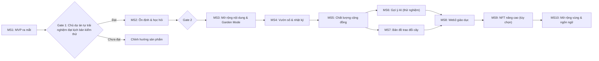

# LỘ TRÌNH MILESTONE SAU MVP – YÊU TRỒNG CÂY

> Liên kết: [KE_HOACH_MVP.md](KE_HOACH_MVP.md) (phạm vi MVP) · [KE_HOACH_XAY_DUNG_YEUTRONGECAY.md](KE_HOACH_XAY_DUNG_YEUTRONGECAY.md) (tầm nhìn dài hạn) · [KIEM_TRA_MOI_TRUONG_PLESK.md](KIEM_TRA_MOI_TRUONG_PLESK.md)
> Trạng thái: **đề xuất, chưa code**. Thời gian tính theo tuần kể từ khi MVP ra mắt và là **ước lượng thô**, cần điều chỉnh theo kết quả thực tế.

## 1. Nguyên tắc để các milestone luôn khớp với MVP

1. **MVP phải chừa sẵn "móc nối" (mục 2)**: những phần rẻ để làm ngay lúc đầu nhưng rất đắt nếu sửa sau (khóa dữ liệu, bảng ảnh, vùng miền, trạng thái kiểm duyệt...).
2. **Mỗi milestone chỉ được bắt đầu khi milestone trước đạt tiêu chí hoàn thành và vượt "cổng quyết định" (gate)**.
3. **Mỗi milestone mở đầu bằng "rà soát khớp MVP" (alignment review)**: đối chiếu schema, `src/types/`, `.gemini/rules/` và tài liệu; sai lệch phải sửa trước khi code tính năng mới.
4. **Mọi thay đổi database đi qua `migrations/` đánh số**, không sửa tay trên phpMyAdmin.
5. **Không đưa tính năng vào MVP "vì sau này cần"**. Chỉ chừa móc nối dữ liệu, không làm sẵn giao diện hay logic.
6. **Khi quyết định kỹ thuật đổi hướng**, ghi lại ngắn gọn (lý do, phương án đã bỏ) trong thư mục `docs/decisions/`.

## 2. Hợp đồng tương thích: những thứ MVP phải làm đúng ngay từ đầu

| # | Móc nối cần có trong MVP | Phục vụ milestone | Lý do |
|---|---|---|---|
| H1 | Mã người dùng nội bộ ổn định (UUID), tách khỏi mã của nhà cung cấp đăng nhập; bảng liên kết danh tính riêng | MS8, MS9 | Sau này gắn ví hoặc đổi nhà cung cấp đăng nhập không phải đổi toàn bộ dữ liệu |
| H2 | Bảng `plants` dùng **tên khoa học làm khóa duy nhất** + `slug` bất biến; bảng `plant_aliases` cho tên địa phương/tiếng Anh | MS3, MS10 | Mở rộng loài và ngôn ngữ không vỡ liên kết |
| H3 | Trường `category` của loài đã có đủ 3 giá trị (`herb`, `fruit`, `ornamental`) dù MVP chỉ có nội dung 2 nhóm | MS3 | Garden Mode thêm sau không cần đổi schema |
| H4 | Trường nullable cho dữ liệu mùa vụ theo vùng (`planting_season_by_region`) | MS3, MS7 | Lịch nông vụ dùng lại khi làm bản đồ trao đổi |
| H5 | Bảng nội dung dùng `content_type` (`question`, `answer`, `diary`, `swap_offer`...) và `status` (`visible`, `pending`, `hidden`) | MS4, MS5, MS7 | Nhật ký, trao đổi cây dùng chung hạ tầng bình luận/kiểm duyệt |
| H6 | Bảng `reports` (báo cáo vi phạm) và `moderation_log` (ai ẩn/xóa gì, vì sao) | MS5 | Kiểm duyệt tự động và Karma cần lịch sử |
| H7 | Bảng `images` riêng: lưu **bản gốc đã tẩy EXIF**, **SHA-256 của bản gốc**, và các bản hiển thị (variant) tách biệt | MS5, MS9 | Watermark chỉ gắn vào variant; hash NFT tính từ bản gốc, không phải sửa dữ liệu cũ |
| H8 | Chỉ lưu **vùng** (tỉnh/thành, quận/huyện), **không lưu tọa độ GPS** người dùng | MS7 | Bản đồ trao đổi dùng vị trí làm mờ, không có dữ liệu nhạy cảm sẵn trong DB |
| H9 | Bảng sự kiện đơn giản (`user_events`: đăng câu hỏi, trả lời, được chọn là đúng, bị báo cáo) | MS5 | Tính Karma từ lịch sử có sẵn thay vì bắt đầu từ 0 |
| H10 | Cột `lang` trên nội dung loài và bài viết (mặc định `vi`) | MS10 | Thêm tiếng Anh không phải đổi cấu trúc |
| H11 | API có tiền tố phiên bản (`/api/v1/...`) và `src/types/` làm hợp đồng dữ liệu | Mọi milestone | Đổi API sau này không phá giao diện cũ |
| H12 | Cơ chế **feature flag** (bật/tắt tính năng bằng cấu hình) | MS3–MS9 | Phát hành dần, tắt nhanh khi có sự cố |
| H13 | Ghi nhận đồng ý/điều khoản người dùng (`consents`) và có trang quyền riêng tư | MS6, MS8 | Dùng AI, ví, vị trí cần có đồng ý rõ ràng |
| H14 | Số đo tối thiểu, không theo dõi cá nhân: số bài đăng, lượt tra cứu, số lần chủ dự án dùng và lỗi gặp phải; thêm số người đăng ký và tỉ lệ quay lại khi có người dùng ngoài | MS2 | Cần số liệu để quyết định ở cổng sau MVP |
| H15 | Quy trình ảnh (resize, tẩy EXIF, đổi tên ngẫu nhiên) viết thành module dùng lại được | MS5 | Thêm watermark/variant là thêm bước, không viết lại |

> Các móc nối trên chỉ là **cấu trúc dữ liệu và quy ước**. Chưa làm giao diện hay logic cho tính năng tương lai.

## 3. Tổng quan milestone

## 4. Chi tiết từng milestone

### MS1 – MVP ra mắt (đã mô tả ở KE_HOACH_MVP.md)
- **Tiêu chí hoàn thành thêm**: đủ 15 móc nối H1–H15, kiểm thử upload ảnh (file giả mạo, ảnh có GPS), có bản sao lưu thử và đã thử khôi phục.

### MS2 – Ổn định & tự trải nghiệm (tuần 1–4 sau MVP)
- **Mục tiêu**: sửa lỗi, đo thực tế, chủ dự án tự trải nghiệm và ghi nhận phản hồi (không phỏng vấn người dùng thử).
- **Phạm vi**: sửa lỗi ưu tiên cao, tối ưu tốc độ, hoàn thiện nội dung 30 loài, chủ dự án dùng hằng ngày trong ít nhất 2 tuần và ghi nhật ký điểm chưa hài lòng, theo dõi số liệu H14.
- **Tiêu chí hoàn thành**: không còn lỗi nghiêm trọng, có danh sách phản hồi của chủ dự án đã xếp ưu tiên.
- **Gate 2 (đề xuất)**: chủ dự án vẫn thấy sản phẩm dùng được và muốn tiếp tục sau 2 tuần tự dùng; không còn lỗi nghiêm trọng. Nếu không đạt, **điều chỉnh sản phẩm trước khi làm tiếp**, không chuyển sang MS3.
- **Lưu ý**: Gate 2 chỉ kiểm tra chức năng và trải nghiệm của một người. Nhu cầu của người dùng ngoài chưa được kiểm chứng, nên các milestone phụ thuộc cộng đồng (MS5, MS7) nên có thêm một bước mời người dùng ngoài trước khi bắt đầu.

### MS3 – Mở rộng nội dung & Garden Mode (tuần 5–10)
- **Phạm vi**: thêm nhóm cây cảnh, mở rộng lên ~50 loài, Garden Mode Switcher (3 chế độ), lịch nông vụ cơ bản, chỉnh cỡ chữ A-/A+ nếu phản hồi cho thấy cần.
- **Dựa vào móc nối**: H2, H3, H4, H12.
- **Tiêu chí hoàn thành**: mọi bài mới có người duyệt; không cần đổi schema để thêm nhóm cây.

### MS4 – Vườn số & nhật ký (tuần 11–16)
- **Phạm vi**: hồ sơ vườn cá nhân, nhật ký ảnh theo cây, so sánh ảnh theo thời gian.
- **Dựa vào móc nối**: H1, H5, H7.
- **Tiêu chí hoàn thành**: người dùng thêm nhật ký mà không phải di chuyển dữ liệu cũ; nhật ký dùng chung quy trình kiểm duyệt.
- **Gate 3**: có người dùng cập nhật nhật ký lặp lại (≥ 2 lần/tháng) hay không. Nếu không, bỏ các tính năng NFT gắn với nhật ký.

### MS5 – Chất lượng cộng đồng (tuần 17–22)
- **Phạm vi**: chọn câu trả lời đúng, Karma tính từ lịch sử sự kiện, kiểm duyệt tự động cơ bản, bộ lọc Sách Đỏ/loài xâm hại, watermark ảnh.
- **Dựa vào móc nối**: H6, H7, H9, H15.
- **Tiêu chí hoàn thành**: số bài vi phạm bị phát hiện và xử lý trong 24 giờ; không có khiếu nại ảnh bị trộm chưa xử lý.

### MS6 – Gợi ý AI cho câu hỏi cây bệnh (thử nghiệm, tuần 23–28)
- **Điều kiện bắt đầu**: chọn được nhà cung cấp với chi phí chấp nhận được, có bộ ảnh mẫu để đo độ chính xác.
- **Phạm vi**: gợi ý sơ bộ **có gắn nhãn "do AI gợi ý, không thay thế chuyên gia"**, người dùng có thể đánh giá hữu ích/không.
- **Dựa vào móc nối**: H13 (đồng ý xử lý ảnh), H5.
- **Tiêu chí hoàn thành**: có số liệu độ chính xác thực tế; nếu thấp, **dừng hoặc giới hạn tính năng**, không công bố là chẩn đoán.

### MS7 – Bản đồ trao đổi cây (song song hoặc sau MS6, tuần 23–30)
- **Phạm vi**: tin trao đổi cành/hạt giống theo khu vực (không GPS chính xác), cảnh báo mùa vụ, hướng dẫn cách ly cây.
- **Dựa vào móc nối**: H4, H5, H8.
- **Tiêu chí hoàn thành**: mọi tin trao đổi đi qua bộ lọc loài cấm; không hiển thị vị trí chính xác.

### MS8 – Web3 giáo dục (tuần 31–36)
- **Điều kiện bắt đầu**: xác minh Testnet và nhà cung cấp ví/Paymaster còn miễn phí.
- **Phạm vi**: trang hướng dẫn, ví nhúng gắn với tài khoản, vòi token thử nghiệm có giới hạn, demo mint hộ chiếu cây đơn giản, nhãn "thử nghiệm – không có giá trị tiền tệ".
- **Dựa vào móc nối**: H1, H7 (hash ảnh), H13.
- **Tiêu chí hoàn thành**: người dùng không phải cài tiện ích ví; không có luồng nào dùng tiền thật.

### MS9 – NFT nâng cao (tùy chọn, tuần 37+)
- **Điều kiện bắt đầu**: MS8 có người dùng thật sự dùng lặp lại và có nhu cầu.
- **Phạm vi có thể**: NFT tiến hóa theo nhật ký, demo ký quỹ giả lập.
- **Nếu MS8 ít người dùng**: bỏ milestone này, giữ ngân sách cho nội dung.

### MS10 – Mở rộng vùng & ngôn ngữ (sau MS9 hoặc song song khi có nhu cầu)
- **Phạm vi**: tiếng Anh cho dữ liệu loài, mở rộng sang loài Đông Nam Á, đánh giá pháp lý theo từng nước.
- **Dựa vào móc nối**: H2, H10.

## 5. Kiểm tra khớp trước mỗi milestone (alignment review)

| Hạng mục kiểm tra | Câu hỏi |
|---|---|
| Schema | Tính năng mới có cần cột/bảng mới? Có thể thêm bằng migration mà không sửa dữ liệu cũ không? |
| Types | `src/types/` đã cập nhật chưa? Giao diện và API cùng khớp không? |
| Rules cho Antigravity | `.gemini/rules/` có cần cập nhật cho tính năng mới không? |
| Bảo mật | Dữ liệu mới có nhạy cảm (vị trí, ảnh, ví)? Cần đồng ý người dùng? |
| Nội dung | Có phần nào cần người chuyên môn duyệt trước khi đăng? |
| Rollback | Nếu tắt feature flag thì hệ thống cũ còn chạy bình thường không? |
| Tài liệu | KE_HOACH_MVP.md, file này và tài liệu gốc đã đồng bộ chưa? |

## 6. Việc cần chủ dự án quyết định

1. Có chấp nhận các **cổng quyết định (Gate)** có thể dừng hoặc đổi hướng lộ trình không?
2. Ngưỡng cụ thể của Gate 1/2/3 (đề xuất ở trên chỉ là gợi ý).
3. Thứ tự MS6 (AI) và MS7 (bản đồ): làm cái nào trước hoặc song song?
4. Web3 (MS8–MS9) có nằm trong cam kết hay chỉ làm nếu người dùng quan tâm?
5. Ngân sách chấp nhận được cho dịch vụ có thể phát sinh (AI, SMS xác thực...) nếu gói miễn phí không đủ.
