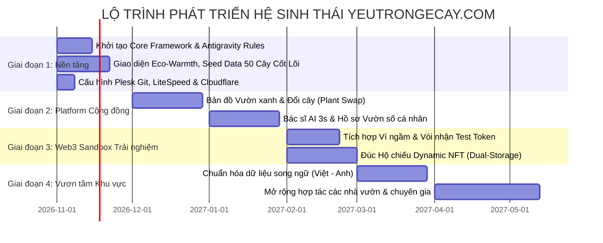

# KẾ HOẠCH TỔNG THỂ: HỆ SINH THÁI SỐ & NỀN TẢNG CỘNG ĐỒNG "YÊU TRỒNG CÂY" (YEUTRONGECAY.COM)

> **Tầm nhìn chiến lược**: Nền tảng số kết nối cộng đồng yêu thực vật lớn nhất Việt Nam – Nuôi dưỡng tình yêu thiên nhiên – Kiến tạo nguồn thu nhập thực tế – Tiên phong giáo dục trải nghiệm công nghệ Web3 hoàn toàn miễn phí.  
> **Thị trường trọng tâm**: Khởi đầu từ Việt Nam (tập trung thảo dược bản địa, cây ăn trái sân vườn và cây cảnh phong thủy), từng bước chuẩn hóa dữ liệu song ngữ để vươn tầm khu vực Đông Nam Á và quốc tế.  
> **Hạ tầng vận hành 0 đồng (Zero-Cost Hybrid Architecture)**: Tối ưu hóa 100% tài nguyên đã trả tiền trên Hosting Plesk Linux Mắt Bão (LiteSpeed, MySQL, Uploads) kết hợp tầng Free Tier vĩnh viễn của Cloudflare và Supabase.  
> **Phương pháp phát triển**: Đội ngũ lập trình viên cộng tác bằng **Antigravity AI Agents** với cơ chế Quản trị phân quyền Zero-Trust GitOps.  
> **Phiên bản hoàn thiện**: Đã tích hợp đầy đủ 20 nâng cấp chuyên sâu sau 6 vòng phản biện (Y tế, Giao diện, Kiến trúc, Web3 Sandbox, An ninh mạng, Quyền riêng tư EXIF, Sao lưu phục hồi, Vận hành thực chiến, Bảo tồn Sách Đỏ, Chia sẻ mạng xã hội, Tiếp cận người lớn tuổi, Gasless NFT và Watermark bản quyền).  
> **Ngày phê duyệt cập nhật**: 04/11/2026

---

## MỤC LỤC
1. [Trụ Cột 1: Tam Giác Sinh Thái Thực Vật, Lịch Nông Vụ & Khung Pháp Lý Y Tế](#1-tam-giác-sinh-thái-thực-vật-lịch-nông-vụ--khung-pháp-lý-y-tế)
2. [Trụ Cột 2: Động Cơ Kinh Tế & Biến Đam Mê Thành Thu Nhập Thực Tế](#2-động-cơ-kinh-tế--biến-đam-mê-thành-thu-nhập-thực-tế)
3. [Trụ Cột 3: Nền Tảng Mạng Xã Hội, Bác Sĩ AI & Bản Đồ Vườn Xanh Có Bảo Vệ Quyền Riêng Tư](#3-nền-tảng-mạng-xã-hội-bác-sĩ-ai--bản-đồ-vườn-xanh)
4. [Trụ Cột 4: Hệ Thống Thiết Kế UI/UX, Lưu Nháp Ngoại Tuyến (Offline-First) & Garden Mode](#4-hệ-thống-thiết-kế-uiux-lưu-nháp-ngoại-tuyến--garden-mode)
5. [Trụ Cột 5: Kiến Trúc Kỹ Thuật Hybrid 0 Đồng, Database Migrations & Sao Lưu Ngoại Vi](#5-kiến-trúc-kỹ-thuật-hybrid-0-đồng-database-migrations--sao-lưu-ngoại-vi)
6. [Trụ Cột 6: Sân Chơi Web3 Sandbox Giáo Dục, Lưu Trữ Kép & NFT Tiến Hóa Động](#6-sân-chơi-web3-sandbox-giáo-dục-lưu-trữ-kép--nft-tiến-hóa-động)
7. [Trụ Cột 7: An Ninh Mạng, Tẩy Sạch EXIF GPS Ẩn & Chống SQL Injection](#7-an-ninh-mạng-tẩy-sạch-exif-gps-ẩn--chống-sql-injection)
8. [Trụ Cột 8: Quy Chuẩn Quản Trị Khi Đội Ngũ Dùng Antigravity AI Agents](#8-quy-chuẩn-quản-trị-khi-đội-ngũ-dùng-antigravity-ai-agents)
9. [Lộ Trình Triển Khai 4 Giai Đoạn (Implementation Roadmap)](#9-lộ-trình-triển-khai-4-giai-đoạn)

---

## 1. TAM GIÁC SINH THÁI THỰC VẬT, LỊCH NÔNG VỤ & KHUNG PHÁP LÝ Y TẾ
*(Khởi đầu từ nguồn gen bản địa Việt Nam, chuẩn hóa dữ liệu song ngữ để vươn tầm quốc tế)*

Hệ thống cây trồng được xây dựng dựa trên **"Tam Giác Sinh Thái Sống" (The Green Living Trinity)** đáp ứng trọn vẹn 3 nhu cầu cốt lõi: Sức khỏe – Ẩm thực – Thẩm mỹ.

```
                  🌿 HỆ SINH THÁI YÊU TRỒNG CÂY 🌿
                               ▲
                              / \
                             /   \
                            /     \
    [1. CÂY THẢO DƯỢC] <───/───────\───> [2. CÂY ĂN TRÁI]
    "Tủ thuốc tự nhiên"                    "Trái ngọt tự tay hái"
    • Húng chanh, tía tô,                  • Ổi lê, cóc Thái, sung Mỹ,
      diếp cá, đinh lăng...                  chanh tứ quý, lựu đỏ...
                            \     /
                             \   /
                              \ /
                               ▼
                        [3. CÂY CẢNH]
                    "Thẩm mỹ & Tâm hồn"
                    • Bonsai, hoa hồng, sen đá,
                      cây phong thủy, lọc khí...
```

### 1.1. Chuẩn Hóa Danh Lục & Tích Hợp Lịch Nông Vụ Nhân Giống (Propagation Phenology)
* **Khóa chính Tên Khoa Học Quốc Tế (Botanical Binomial)**: Quy tụ mọi tên gọi địa phương (*Húng chanh* miền Bắc = *Tần dày lá* miền Nam) về một thực thể dữ liệu duy nhất (`Plectranthus amboinicus`).
* **Lịch Nông Vụ Nhân Giống**: Cảnh báo thời tiết theo mùa để tránh chết cành khi giao lưu:
  * Ví dụ: Hệ thống cảnh báo tự động: *"Tháng 11 đang lạnh sương muối ở miền Bắc và mưa dầm ở miền Trung, tỷ lệ sống của cành chiết Đinh Lăng chỉ đạt 20%. Thời điểm lý tưởng nhất để nhân giống là Tháng 2 - Tháng 4 (Mùa xuân)!"*.
* **Bộ dữ liệu mồi chuẩn hóa ngày ra mắt (Day 1 Seed Data)**: 50 loài cây cốt lõi (20 thảo dược, 15 cây ăn trái đô thị, 15 cây cảnh phong thủy) với hướng dẫn cách trồng chi tiết.

### 1.2. Nhóm 1: Cây Thảo Dược & Dược Thực Đồng Nguyên (Food-as-Medicine)
* Gia vị kiêm kháng sinh tự nhiên: Húng chanh, tía tô, diếp cá, lá lốt, gừng gió, nghệ nếp đỏ, sả chanh.
* Cây thuốc quý trồng chậu: Đinh lăng nếp lá nhỏ, ngải cứu, cà gai leo, xuyên tâm liên, bồ công anh, sâm đại hành.
* Rau rừng & Siêu thực phẩm: Chùm ngây (Moringa), rau bồ ngót Nhật, rau càng cua, rau lủi.

> 🛡️ **QUY CHUẨN AN TOÀN Y TẾ & PHÁP LÝ (BẮT BUỘC TRÊN TOÀN NỀN TẢNG)**:
> 1. **Khung từ chối trách nhiệm y khoa (Medical Disclaimer)**: Mọi bài viết thảo dược tự động đính kèm thông báo: *"Thông tin mang tính chất chia sẻ kinh nghiệm dân gian, không thay thế chẩn đoán hay phác đồ điều trị của bác sĩ chuyên khoa"*.
> 2. **Hệ thống nhãn cảnh báo tương kỵ & liều lượng (Toxicity Badges)**:
>    * Cây Đinh Lăng: `[⚠️ Cảnh báo: Chứa nhiều Saponin, không uống quá liều liên tục]`.
>    * Cây Rau Ngót: `[⚠️ Cảnh báo: Phụ nữ mang thai 3 tháng đầu hạn chế dùng]`.
> 3. **Ảnh đối chiếu phân biệt cây dễ nhầm lẫn**: Tránh hái nhầm các loại cây hoang dã có độc tính.

> 🌳 **BỘ LỌC BẢO TỒN SÁCH ĐỎ & LOÀI XÂM HẠI (Redlist & Invasive Species Gatekeeper)**:
> 1. Tự động quét từ khóa và cảnh báo/chặn các bài đăng trao đổi, mua bán loài thuộc danh mục cấm khai thác theo quy định pháp luật Việt Nam (Sách Đỏ, Nghị định 06/2019/NĐ-CP, Nghị định 84/2021/NĐ-CP): lan hài quý hiếm, trầm hương tự nhiên, sâm Ngọc Linh rừng tự nhiên...
> 2. Cảnh báo/chặn phát tán các loài ngoại lai xâm hại (Cúc bướm, Mai dương, Bèo tây, Cỏ lào...).
> 3. Cẩm nang giáo dục: *"Bảo tồn nguồn gen bản địa – nói KHÔNG với khai thác cây rừng tự nhiên"*.
> 4. Danh mục cấm/xâm hại do quản trị viên cập nhật định kỳ theo văn bản pháp luật hiện hành (cần đối chiếu nguồn chính thức khi triển khai).

### 1.3. Nhóm 2: Cây Ăn Trái Đô Thị & Nhóm 3: Cây Cảnh Bonsai Nghệ Thuật
* Cây ăn trái: Ổi lê, Chanh tứ quý, Cóc Thái lùn, Sung Mỹ, Lựu đỏ lùn Ấn Độ, Táo ta, Dâu tây.
* Cây cảnh: Mai vàng, Đào Tết, Mai chiếu thủy, Sanh, Tùng la hán, Kim tiền, Lưỡi hổ, Hoa hồng cổ, Sen đá.

---

## 2. ĐỘNG CƠ KINH TẾ & BIẾN ĐAM MÊ THÀNH THU NHẬP THỰC TẾ
*(Actionable Monetization Engine)*

1. **Kinh doanh cây giống & Cành chiết thuần hữu cơ tại nhà**: Bán cành chiết đinh lăng nếp, giống ổi lùn năng suất, giống cóc ghép, bầu cây húng chanh sạch.
2. **Chế biến sâu nông sản & Thảo dược thủ công gia đình**: Nấu siro húng chanh quất mật ong; sấy lạnh trà lá tía tô sả chanh; ngâm mật ong tỏi gừng thủ công.
3. **Dịch vụ Setup & Cứu cây mảng xanh đô thị**: Thiết kế trọn gói "Tủ thuốc xanh ban công" và "Vườn cây ăn trái sân thượng"; dịch vụ xử lý úng rễ, ghép mắt, kích hoa đậu trái.
4. **Tiếp thị liên kết & Phân phối vật tư chọn lọc**: Đất trộn kiểng lá, đất tơi xốp cho cây ăn quả chậu, đèn quang hợp bổ sung nắng, hệ thống tưới tự động.

---

## 3. NỀN TẢNG MẠNG XÃ HỘI, BÁC SĨ AI & BẢN ĐỒ VƯỜN XANH
*(Plant-Social Platform Engine)*

```
┌────────────────────────────────────────────────────────────────────────┐
│             HỆ SINH THÁI CỘNG ĐỒNG "YÊU TRỒNG CÂY" PLATFORM             │
├───────────────────┬───────────────────┬────────────────────────────────┤
│ 1. BẢN ĐỒ VƯỜN XANH│ 2. VƯỜN SỐ CỦA TÔI│ 3. BÁC SĨ CÂY TRỒNG (HỎI ĐÁP)  │
│ (Green Map / Swap)│ (Digital Garden)  │ (AI Co-Pilot & Community)      │
│ • Định vị bạn chơi │ • Khoe góc vườn,  │ • AI phản hồi sơ bộ trong 3s   │
│   cây theo khu vực │   ban công cá nhân│ • Cộng đồng bổ sung theo vùng  │
│ • Trao đổi cành    │ • Nhật ký lớn lên │ • Tích điểm uy tín (Karma)     │
│   giâm, hạt giống  │   qua ảnh tuần    │   cho câu trả lời chuẩn xác    │
├───────────────────┴───────────────────┴────────────────────────────────┤
│ 4. HỘI QUÁN CHUYÊN SÂU & SÀN GIAO LƯU P2P (Community Exchange)         │
│ • Hội Vườn Thuốc Nam, Hội Cây Ăn Trái Sân Thượng, Hội Bonsai           │
│ • Giao lưu cành chiết an toàn kèm quy trình kiểm dịch cách ly 7 ngày   │
└────────────────────────────────────────────────────────────────────────┘
```

* **Trợ Lý Bác Sĩ Cây Trồng AI Tức Thì (Instant AI Co-Pilot Clinic)**:
  * Người dùng đăng ảnh lá bệnh -> AI đưa ra phân tích sơ bộ trong **3 giây** (giải quyết triệt để hiệu ứng "Phố vắng" ngày đầu), sau đó các nhà vườn trong khu vực vào tư vấn chuyên sâu.
* **Bản Đồ Vườn Xanh & Đổi Cây An Toàn (Local Plant Swap Map)**:
  * Tìm kiếm bạn chơi cây cùng bán kính 1km - 5km. Cẩm nang cách ly cây 7 ngày chống lây lan nấm rệp chéo giữa các vườn.

---

## 4. HỆ THỐNG THIẾT KẾ UI/UX, LƯU NHÁP NGOẠI TUYẾN & GARDEN MODE
*(UI/UX System & Offline-First UX)*

### 4.1. Cơ Chế Lưu Nháp Ngoại Tuyến (Offline-First Draft with IndexedDB)
* Giải quyết triệt để sự cố **sóng Wi-Fi/4G chập chờn khi người dùng ra góc sân thượng/ban công**:
  * Chữ gõ và ảnh chụp được lưu đệm tạm thời vào bộ nhớ trình duyệt điện thoại (`IndexedDB / LocalStorage`).
  * Khi mất mạng: Thông báo thân thiện *"Đang ở vùng sóng yếu, bài đăng đã được lưu an toàn. Hệ thống sẽ tự động tải lên ngay khi bạn có kết nối lại!"*, không bao giờ làm mất dữ liệu của người dùng.

### 4.2. Bộ Chuyển Đổi Chế Độ Vườn (Garden Mode Switcher)
```
┌────────────────────────────────────────────────────────────────────────┐
│  [🌿 TỦ THUỐC XANH]   │   [🍋 TRÁI NGỌT PHỐ]   │   [🌸 CÂY CẢNH THƯ THÁI]│
└────────────────────────────────────────────────────────────────────────┘
```
* Phân luồng độc lập: Người tìm bài thuốc dân gian, người học cách trồng ổi trong chậu, và người ngắm Bonsai hoa cảnh có trải nghiệm chuyên biệt, không bị lẫn lộn thông tin.

### 4.3. Thiết Kế Đa Thế Hệ Cho Người Trung Niên & Lớn Tuổi (Accessibility 50–75 tuổi)
* **Tìm kiếm bằng giọng nói tiếng Việt (Voice Search 1-chạm)**: Nút micro ngay tại thanh tìm kiếm, nói *"Cách cứu cây ổi bị rụng quả"* hoặc *"Tía tô trồng mùa nào"* là mở đúng bài viết (dùng Web Speech API của trình duyệt, miễn phí).
* **Thanh chỉnh cỡ chữ `A- / A+`**: Phóng to bài cẩm nang 120%–140% chỉ với 1 chạm; mặc định tương phản cao, nút bấm lớn.

### 4.4. Bảng mã màu nhận diện (Design Tokens)
* `Primary Forest`: `#0F2E1E` (Xanh rừng nguyên sinh).
* `Herbal Green`: `#16A34A` / `#22C55E` (Xanh lá thảo dược – nút hành động CTA).
* `Terracotta Earth`: `#C86D51` (Đất nung chậu gốm mộc).
* `Alabaster Cream`: `#F9FBF9` (Nền sáng thở tự nhiên).
* `Dark Slate / Charcoal`: `#0C100E` (Chế độ Dark Mode chống lóa mắt).

---

## 5. KIẾN TRÚC KỸ THUẬT HYBRID 0 ĐỒNG, DATABASE MIGRATIONS & SAO LƯU NGOẠI VI
*(Zero-Cost Operational Architecture & Disaster Recovery)*

```
┌────────────────────────────────────────────────────────────────────────┐
│             MÔ HÌNH CHIA TẢI THÔNG MINH - CHI PHÍ VẬN HÀNH 0 ĐỒNG       │
├────────────────────────────────────────────────────────────────────────┤
│ 1. PLESK HOSTING MẮT BÃO (Đã trả tiền - Tận dụng tối đa):              │
│    • Phân phối giao diện Frontend (React Vite Build tĩnh qua LiteSpeed)│
│    • LƯU TRỮ HÌNH ẢNH: Toàn bộ ảnh cây cảnh, lá bệnh lưu tại thư mục   │
│      `/httpdocs/uploads/` trên ổ cứng SSD/NVMe của Plesk.              │
│    • CƠ SỞ DỮ LIỆU MYSQL: Sử dụng MariaDB/MySQL có sẵn trên Plesk để  │
│      lưu trữ bài viết cẩm nang, dữ liệu cây, bình luận thành viên.     │
│    • PHP 8.3 REST API: Nhẹ nhàng, xử lý upload ảnh an toàn và truy vấn.│
├────────────────────────────────────────────────────────────────────────┤
│ 2. CLOUDFLARE (Gói Free vĩnh viễn):                                   │
│    • Bọc ngoài tên miền yeutrongcay.com: Chống DDoS, bảo vệ WAF.       │
│    • Edge Caching: Lưu đệm toàn bộ ảnh trong `/uploads/*` 30 ngày,     │
│      giảm 80% băng thông tải về cho hosting Mắt Bão.                   │
├────────────────────────────────────────────────────────────────────────┤
│ 3. SUPABASE (Gói Free vĩnh viễn):                                     │
│    • Quản lý đăng nhập Google / Email (Authentication miễn phí 50.000  │
│      thành viên).                                                      │
│    • Tính năng Bác sĩ cây trồng thông báo Realtime tức thì.           │
├────────────────────────────────────────────────────────────────────────┤
│ 4. WEB3 TESTNET (Polygon Amoy / Base Sepolia):                         │
│    • Smart Contracts thử nghiệm, token gas từ vòi (Faucet) 0 đồng.     │
└────────────────────────────────────────────────────────────────────────┘
```

### 5.1. Chiến Lược Sao Lưu Ngoại Vi Tự Động (Off-site Disaster Recovery 0 Đồng)
* Phòng ngừa rủi ro phần cứng hosting Mắt Bão gặp sự cố:
  * Cấu hình **Plesk Backup Manager** tự động nén toàn bộ MySQL và thư mục `/uploads/` vào 2h sáng hàng ngày.
  * Tự động đẩy file backup mã hóa sang **Google Drive** hoặc **Cloudflare R2** (miễn phí 10GB lưu trữ). Khôi phục nguyên vẹn chỉ trong 5 phút khi có sự cố.

### 5.2. Cầu Nối OpenGraph Cho Chia Sẻ Zalo/Facebook (Social Share Bridge)
* **Vấn đề**: React SPA không có HTML sẵn cho bot (`zalo-bot`, `facebookexternalhit`, ...), link chia sẻ bị trắng ảnh/tiêu đề, mất phần lớn lưu lượng lan truyền.
* **Giải pháp**: Rule rewrite trên LiteSpeed (`.htaccess`) nhận diện User-Agent của bot mạng xã hội và chuyển tới một file PHP siêu nhẹ, trả về HTML tối thiểu chứa `og:title`, `og:description`, `og:image`, `og:url` lấy từ MySQL (ảnh đã watermark). Người dùng thật vẫn nhận giao diện React bình thường. Cần kiểm thử bằng công cụ debug của Facebook và Zalo trước khi phát hành.

### 5.3. Database Migrations Bắt Buộc & Xác Thực JWT Cục Bộ
* Mọi thay đổi bảng phải lưu thành file migration đánh số thứ tự trong `migrations/` (`001_initial_schema.sql`, `002_add_clinic_table.sql`). Cấm sửa bảng thủ công trên phpMyAdmin.
* PHP giải mã chữ ký JWT HMAC-SHA256 **ngay trên RAM trong 0.1ms**, không gọi mạng ra ngoài. Cronjob định kỳ trên Plesk chống Supabase ngủ đông.

---

## 6. SÂN CHƠI WEB3 SANDBOX GIÁO DỤC, LƯU TRỮ KÉP & NFT TIẾN HÓA ĐỘNG
*(Educational Web3 & Dynamic Evolution NFT)*

### 6.1. Nguyên tắc cốt lõi: 100% Phi Thương Mại & An Toàn Tuyệt Đối
* **KHÔNG sử dụng tiền thật, KHÔNG giao dịch crypto thương mại**: Triệt tiêu 100% rủi ro pháp lý tại Việt Nam và bảo vệ người dùng không bị mất tiền.
* **Mục tiêu**: Giúp người yêu cây tiếp cận, hiểu và làm quen với công nghệ Blockchain và NFT của tương lai một cách trực quan, vui vẻ.

### 6.2. Hộ Chiếu Cây Tiến Hóa Số (Dynamic Evolving Plant NFT)
Giải quyết triệt để vấn đề "đúc NFT xong bị lãng quên":
* NFT phản ánh đúng sự lớn lên của cái cây ngoài đời thực:
  * **Cấp 1 (Hạt mầm/Cành chiết)**: Khi mới đúc Hộ chiếu NFT.
  * **Cấp 2 (Cây sinh trưởng phân cành)**: Khi người dùng cập nhật ảnh cây sau 30 ngày.
  * **Cấp 3 (Cây đơm hoa / Ra trái / Cây đại thụ)**: Khi người dùng gắn bó cập nhật hành trình sau 6 tháng.

### 6.3. Cơ Chế Lưu Trữ Kép (Dual-Storage) & Chống Spam Rate Limit
* **Lưu trữ kép**: Ảnh gốc lưu trên Plesk Mắt Bão (Cloudflare CDN) + Nhúng mã băm **SHA-256 Hash** của ảnh vào Smart Contract Testnet. Chống mất ảnh vĩnh viễn!
* **Giới hạn tốc độ**: Mỗi tài khoản Google chỉ được nhận Faucet **1 lần/24h** (100 Mầm Xanh) và đúc tối đa **3 Hộ chiếu NFT/ngày**.

### 6.4. Đúc Hộ Chiếu 1-Chạm Không Phí Gas (Gasless Paymaster)
* Người dùng chỉ bấm **"Tạo Hộ Chiếu Số"**, không thấy popup Gas/Gwei/Nonce gây hoang mang.
* Áp dụng Account Abstraction (ERC-4337) với Paymaster trả phí gas Testnet ở hậu trường (ví dụ Pimlico/Biconomy hoặc ví nhúng Privy/Thirdweb), kết hợp rate limit mục 6.3.
* Giao diện luôn gắn nhãn rõ ràng **"Chế độ thử nghiệm – không có giá trị tiền tệ"**. Cần xác minh mạng Testnet và nhà cung cấp còn hỗ trợ gói miễn phí tại thời điểm triển khai.

---

## 7. AN NINH MẠNG, TẨY SẠCH EXIF GPS ẨN & CHỐNG SQL INJECTION
*(Cybersecurity & Privacy Protection)*

### 7.1. Tẩy Sạch 100% Tọa Độ GPS Ẩn Trong Ảnh Chụp (EXIF GPS Stripping)
* **Bảo vệ an toàn nơi ở tuyệt đối cho thành viên**:
  * Camera điện thoại mặc định nhúng tọa độ GPS chính xác đến từng mét vào phần EXIF của ảnh chụp.
  * Mã PHP upload trên Plesk **BẮT BUỘC PHẢI TẨY SẠCH 100% SIÊU DỮ LIỆU EXIF (xóa sạch GPS, ngày giờ, tên thiết bị)** trước khi lưu ảnh vào đĩa cứng. Triệt tiêu hoàn toàn nguy cơ kẻ gian tìm ra vị trí nhà riêng của chủ cây!

### 7.2. Chặn Đứng Mã Độc Trong Thư Mục Ảnh (`/uploads/`)
* File `.htaccess` trong `/uploads/` cấm máy chủ LiteSpeed thực thi bất kỳ đoạn script nào:
  ```apache
  <FilesMatch "\.(php|php5|php8|phtml|pl|py|cgi)$">
      Order Deny,Allow
      Deny from all
  </FilesMatch>
  ```
* Mã PHP kiểm tra MIME Type thật qua Magic Bytes (`getimagesize()`), đổi tên file ngẫu nhiên sang định dạng WebP (ví dụ: `plant_9f8a3c21.webp`).

### 7.3. Chuẩn Hóa Chống SQL Injection Cho Toàn Bộ AI Agents
* **Quy tắc bất biến**: 100% mã PHP trên Plesk **BẮT BUỘC PHẢI SỬ DỤNG PDO VỚI PREPARED STATEMENTS** (`bindValue / execute`). Cấm tuyệt đối việc nối chuỗi biến trực tiếp vào câu lệnh SQL.

### 7.4. Hàng Rào Lọc Spam & Bảo Vệ Tên Miền Tại Mắt Bão
* Tự động lọc từ khóa đen (link cờ bạc, lừa đảo tài chính) và cơ chế ẩn bài tự động khi có 3 cờ báo cáo vi phạm, triệt tiêu nguy cơ Mắt Bão tạm khóa tên miền `yeutrongcay.com`.

### 7.5. Đóng Dấu Bản Quyền Chìm Tự Động (Dynamic Watermark)
* Khi xử lý ảnh upload (sau bước tẩy EXIF), PHP gắn dấu mờ tinh tế ở góc dưới: `🌿 yeutrongcay.com • @ten_thanh_vien`.
* Tác dụng: ngăn trộm ảnh để lập trang giả bán giống lừa đảo, đồng thời quảng bá thương hiệu khi ảnh được chia sẻ. Giữ bản gốc đã tẩy EXIF (không watermark) để dùng cho SHA-256 hash của NFT.

---

## 8. QUY CHUẨN QUẢN TRỊ KHI ĐỘI NGŨ DÙNG ANTIGRAVITY AI AGENTS
*(Agentic DevSecOps Governance)*

```
yeutrongcay/
├── .gemini/
│   └── rules/
│       ├── architecture.md       <-- Chuẩn React 18, Vite, Tailwind, Zustand
│       ├── design-tokens.md      <-- Bảng màu Botanical, typography, quy chuẩn UI
│       ├── plant-domains.md      <-- Quy chuẩn 3 nhóm: Thảo dược, Cây ăn trái, Cây cảnh
│       ├── web3-sandbox.md       <-- Quy định mạng Testnet, Faucet, Dynamic NFT, Rate Limit
│       ├── php-standards.md      <-- Ép buộc PDO Prepared Statements 100%, bảo mật JWT
│       ├── database-rules.md     <-- Quy chuẩn Database Migrations có đánh số phiên bản
│       └── security-guard.md     <-- Tẩy sạch EXIF GPS, cấm commit secret .env
├── src/
│   ├── types/                    <-- Hợp đồng dữ liệu bắt buộc (Plant, Post, Clinic, Passport)
│   ├── features/                 <-- Các module độc lập theo tính năng
│   └── lib/                      <-- Tiện ích chung (Supabase, Web3, API client)
├── migrations/                   <-- File SQL migration đánh số thứ tự (001_..., 002_...)
├── api/                          <-- PHP 8.3 REST API an toàn chạy trên Plesk
└── package.json
```

---

## 9. LỘ TRÌNH TRIỂN KHAI 4 GIAI ĐOẠN



---
*(Bản kế hoạch đã được cập nhật toàn diện và chính thức đóng băng. Hệ thống ở trạng thái CHỜ LỆNH trực tiếp từ Chủ dự án để bắt đầu khởi tạo mã nguồn).*
