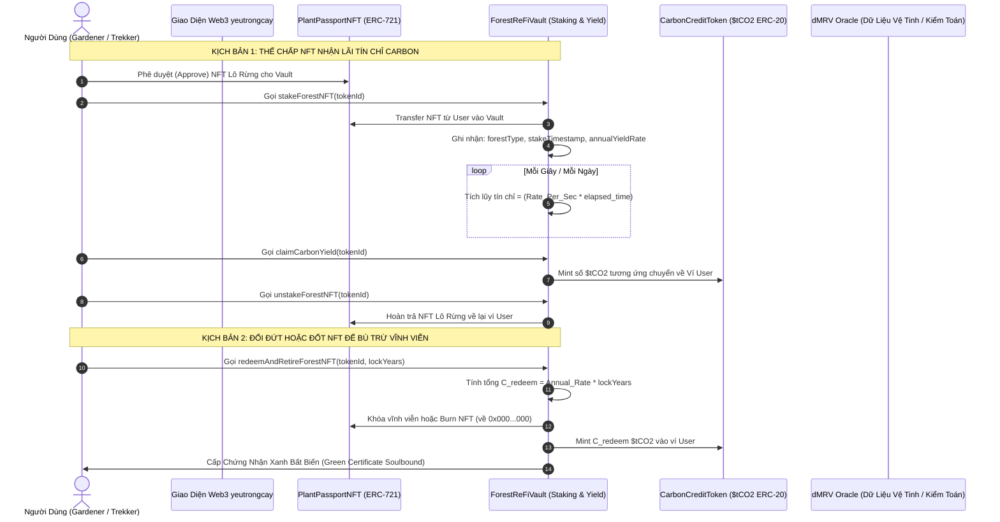

# BÁO CÁO NGHIÊN CỨU & XÂY DỰNG BỘ CÔNG THỨC QUY ĐỔI TÍN CHỈ CARBON TỪ NFT LÔ RỪNG TỰ NHIÊN (REFI YEUTRONGECAY.COM)

> **Mã văn kiện:** RES-REFI-FOREST-CARBON-V1  
> **Áp dụng cho:** Hệ thống Tài chính Tái tạo (ReFi) & Hộ Chiếu Rừng Số (`geo_forest_10000m2`)  
> **Cơ sở khoa học:** IPCC 2006/2019 AFOLU, Tiêu chuẩn Verra VCS (VM0007 / VM0015), Cục Lâm Nghiệp Việt Nam & Viện FIPI.  
> **Mục tiêu:** Định lượng chính xác số Tín chỉ Carbon ($tCO_2e$) sinh ra từ 1 NFT Lô Rừng ($10.000\text{ m}^2 = 1\text{ ha}$) để phục vụ 2 cơ chế: **(1) Thế chấp NFT nhận dòng lãi Tín chỉ Carbon định kỳ** và **(2) Đổi/Đốt NFT lấy trọn gói Tín chỉ Carbon**.

---

## 1. TỔNG QUAN VẤN ĐỀ & MÔ HÌNH KINH TẾ REFI

Trong hệ sinh thái **Yêu Trồng Cây**, mỗi NFT Lô Rừng thuộc lớp tài sản `geo_forest_10000m2` đại diện cho quyền bảo trợ và kiểm toán sinh thái của đúng **1 hecta ($10.000\text{ m}^2$)** rừng tự nhiên (như Vườn Quốc Gia Cúc Phương, Đầm Than Bùn U Minh Hạ, Rừng Ngập Mặn Cần Giờ, Rừng Ba Bể).

```
                            ┌────────────────────────────────────────────────────────┐
                            │      NFT LÔ RỪNG (10.000 m² = 1 ha Rừng Thực Tế)       │
                            │              Chuẩn ERC-721 / CIP-68                    │
                            └───────────────────────────┬────────────────────────────┘
                                                        │
                         ┌──────────────────────────────┴──────────────────────────────┐
                         ▼                                                             ▼
          [CƠ CHẾ 1: THẾ CHẤP LẤY LÃI]                                 [CƠ CHẾ 2: ĐỔI TRỌN GÓI / RETIRE]
         (Staking / Yield Streaming)                                       (Burn / Offset Redemption)
                         │                                                             │
        - Khóa NFT vào ReFi Vault                                    - Khóa/Đốt NFT theo kỳ hạn (3-5-10 năm)
        - Cây rừng tiếp tục quang hợp hàng ngày                      - Nhận trọn gói $tCO_2e$ tích lũy
        - Nhận lãi định kỳ ($tCO_2e$ Token / $CARB)                  - Đúc Chứng thư Bù trừ Carbon (Soulbound)
        - Mở khóa (Unstake) lấy lại NFT bất kỳ lúc nào               - NFT chuyển sang trạng thái "Retired"
```

---

## 2. NGUYÊN LÝ KHOA HỌC & 5 BỂ CARBON RỪNG (IPCC GUIDELINES)

Theo Hướng dẫn Kiểm kê Khí nhà kính Quốc gia của IPCC (IPCC 2006 Guidelines for National Greenhouse Gas Inventories & 2019 Refinement) trong lĩnh vực Nông nghiệp, Lâm nghiệp và Sử dụng đất khác (AFOLU), tổng trữ lượng carbon của một hệ sinh thái rừng được lưu giữ trong **5 bể chứa (Carbon Pools)**:

```
┌──────────────────────────────────────────────────────────────────────────────────┐
│                             5 BỂ CHỨA CARBON CỦA RỪNG                            │
├──────────────────────────┬───────────────────────────────────────────────────────┤
│ 1. Sinh khối trên mặt đất│ Thân cây gỗ, cành, lá, chồi, vỏ cây (AGB)             │
│ 2. Sinh khối dưới mặt đất│ Hệ thống rễ cọc, rễ chùm ngầm dưới đất (BGB)          │
│ 3. Gỗ chết               │ Cây đổ mục, cành khô nằm trên mặt đất rừng (DW)       │
│ 4. Thảm mục & lá rụng    │ Lá rụng, vỏ mục phân hủy trên tầng mặt (Litter - LI)  │
│ 5. Carbon hữu cơ thổ nhưỡng│ Tầng đất hữu cơ, đặc biệt là than bùn & bùn mặn (SOC) │
└──────────────────────────┴───────────────────────────────────────────────────────┘
```

Công thức chuyển đổi từ nguyên tố Carbon ($C$) sang Carbon Dioxide tương đương ($CO_2e$):
$$\text{Khối lượng } CO_2e = \text{Khối lượng } C \times \frac{44}{12} \approx \text{Khối lượng } C \times 3.667$$

Trong đó:
* $44$: Khối lượng phân tử của $CO_2$ ($12 \text{ (C)} + 16 \times 2 \text{ (O)}$).
* $12$: Khối lượng nguyên tử của $C$.
* Mỗi tấn Carbon nguyên tố tương đương với **$3.667$ tấn $CO_2$**.

---

## 3. BỘ CÔNG THỨC QUY ĐỔI TÍN CHỈ CARBON TOÀN DIỆN

### 3.1. Công thức 1: Lượng Tín Chỉ Carbon Hấp Thụ Hàng Năm (Cơ chế Thế chấp lấy lãi)

Khi người dùng thế chấp (stake) NFT Lô Rừng vào Vault, lượng tín chỉ carbon sinh ra trong 1 năm ($\Delta C_{annual}$, tính bằng $tCO_2e/\text{năm/NFT}$) được tính theo công thức sinh khối gia tăng ròng:

$$\Delta C_{annual} = \left[ \Delta AGB \times (1 + R) \times CF \times \frac{44}{12} + \Delta SOC \times \frac{44}{12} \right] \times A \times (1 - B_{risk})$$

**Giải thích các biến số:**
* $A$: Diện tích của 1 NFT Lô Rừng ($A = 1\text{ ha} = 10.000\text{ m}^2$).
* $\Delta AGB$: Lượng tăng trưởng sinh khối khô trên mặt đất bình quân hàng năm của loại rừng đó ($\text{tấn vật chất khô/ha/năm}$).
* $R$: Tỷ lệ sinh khối rễ dưới mặt đất so với sinh khối thân trên mặt đất (**Root-to-shoot ratio** - $BGB / AGB$). Theo IPCC:
  * Rừng mưa nhiệt đới cạn: $R \approx 0.20 - 0.24$.
  * Rừng ngập mặn (hệ rễ chống khổng lồ): $R \approx 0.35 - 0.49$.
  * Rừng tràm than bùn: $R \approx 0.28 - 0.32$.
* $CF$: Tỷ lệ hàm lượng carbon trong vật chất khô thảo mộc (**Carbon Fraction**). Chuẩn IPCC mặc định là **$CF = 0.47$** (tức 47% sinh khối gỗ khô là carbon).
* $\Delta SOC$: Lượng carbon hữu cơ gia tăng hoặc bảo toàn trong đất than bùn/trầm tích ngập mặn hàng năm ($\text{tấn C/ha/năm}$). Với rừng cạn ổn định, $\Delta SOC \approx 0.1 - 0.3\text{ tC/ha/năm}$; với rừng ngập mặn/than bùn, con số này có thể đạt $1.5 - 4.5\text{ tC/ha/năm}$.
* $B_{risk}$: **Hệ số đệm dự phòng rủi ro (Buffer Risk Deduction)**. Theo tiêu chuẩn quốc tế Verra VCS, luôn phải trích lập **$15\% - 20\%$** sản lượng tín chỉ vào bể dự phòng bảo hiểm rủi ro thiên tai (cháy rừng, hạn hán, bão lũ). Mặc định hệ thống cài đặt $B_{risk} = 0.15$ ($15\%$).

---

### 3.2. Công thức 2: Dòng Lãi Tín Chỉ Từng Giây (Real-time Yield Streaming)

Để người dùng nhìn thấy số dư tín chỉ carbon tăng trưởng từng giây trên giao diện Web3, tốc độ sinh lãi trên giây ($Y_{sec}$) của 1 NFT được xác định như sau:

$$Y_{sec} = \frac{\Delta C_{annual}}{365 \times 86.400} = \frac{\Delta C_{annual}}{31.536.000} \quad (tCO_2e/\text{giây})$$

Tổng số tín chỉ người dùng có thể claim tại thời điểm $t$:
$$C_{unclaimed}(t) = C_{accumulated} + \sum_{i=1}^{N_{NFT}} \left[ Y_{sec}^{(i)} \times (t - t_{last\_claim}) \right]$$

---

### 3.3. Công thức 3: Quy Đổi Trọn Gói Khi Đổi / Đốt NFT (Redemption & Retirement)

Khi người dùng không muốn nhận lãi hàng năm mà muốn **Đổi đứt hoặc Đốt NFT** để lấy trọn gói Tín chỉ Carbon phục vụ bù trừ phát thải (Carbon Offsetting) cho cá nhân hoặc doanh nghiệp:

$$C_{redeem} = \left[ C_{absorbed\_past} + C_{future\_guarantee}(T) \right] \times (1 - D_{liquidity})$$

Trong đó:
* $C_{absorbed\_past}$: Lượng carbon đã tích lũy trong quá khứ kể từ thời điểm đúc NFT mà chưa claim.
* $C_{future\_guarantee}(T)$: Lượng carbon cam kết bảo tồn trong kỳ hạn tương lai $T$ năm (ví dụ $T = 3, 5, 10$ năm):
  $$C_{future\_guarantee}(T) = \Delta C_{annual} \times T \times \frac{1}{(1 + r)^T}$$
  *(Với $r$ là tỷ lệ chiết khấu thời gian sinh học, khuyến nghị $r = 0.03$ tức 3%/năm).*
* $D_{liquidity}$: Phí thanh khoản/xử lý hồ sơ kiểm toán chứng nhận on-chain (thường là $2\% - 5\%$).

---

### 3.4. Mô Hình Giáo Dục Nén Thời Gian Trong Sandbox (Educational Time-Compression & Instant Feedback)

> [!IMPORTANT]
> **Triết lý Thiết kế Giáo dục (Education-First UX):**  
> Trong thực tế lâm nghiệp, chu kỳ sinh trưởng của cây rừng tính bằng hàng năm. Tuy nhiên, nếu trên website bắt người dùng phải chờ 1 tháng hay 1 năm mới thấy được kết quả thì **không thể giáo dục được người dùng phổ thông**.  
> Vì vậy, trong phân hệ Sandbox Giáo Dục, hệ thống áp dụng **"Cơ chế Nén Thời Gian Thực Nghiệm" (Educational Accelerated Simulation)**:

1. **Tỷ Lệ Nén Thời Gian (Time-Compression Factor $\Phi$)**:
   $$\Phi = 31.536.000 / 60 \approx 525.600\times$$
   * **1 phút mô phỏng trên màn hình = 1 năm hấp thụ carbon ngoài thực tế**.
   * Cứ mỗi **5 giây trôi qua** = Rừng hoàn thành 1 tháng quang hợp tích lũy carbon.
   * Số dư $tCO_2e$ nhảy mượt mà trực tiếp trước mắt (Live Ticker) với 4 chữ số thập phân (`+0.0012 tCO2e...`).
2. **Nút Thao Tác Nhanh (Fast-Forward Educational Controls)**:
   * Cho phép người dùng bấm thử nghiệm ngay các kịch bản thời gian mà không cần chờ:
     * `[Mô phỏng 1 Tháng]` $\rightarrow$ Lập tức sinh ra $\approx 1.0 - 1.2\text{ } tCO_2e$.
     * `[Mô phỏng 1 Năm]` $\rightarrow$ Lập tức sinh ra $\approx 11 - 15\text{ } tCO_2e$.
     * `[Mô phỏng 5 Năm]` $\rightarrow$ Lập tức sinh ra $\approx 55 - 75\text{ } tCO_2e$.
3. **Quy Đổi Sang Chỉ Số Đời Thường Dễ Hiểu (Tangible Everyday Metrics)**:
   Để người dùng hiểu giá trị của 1 Tín chỉ Carbon ($1\text{ } tCO_2e$), giao diện hiển thị bảng so sánh trực quan gần gũi:
   * **$0.25\text{ } tCO_2e$** $\approx$ Bù trừ phát thải của **1 chuyến bay khứ hồi Hà Nội ↔ TP.HCM** ✈️
   * **$0.45\text{ } tCO_2e$** $\approx$ Bù trừ lượng khí thải phát ra khi **chạy xe máy xăng suốt 1 năm** 🛵
   * **$1.50\text{ } tCO_2e$** $\approx$ Bù trừ lượng điện sinh hoạt của **1 hộ gia đình trong cả năm** ⚡
   * **$15.00\text{ } tCO_2e$ (1 Lô Rừng Cúc Phương/năm)** $\approx$ Bằng sức hấp thụ của **750 cây xanh đô thị** trồng mới 🌳
4. **Vòng Lặp Trải Nghiệm Học Tập Khép Kín Trong 2 Phút (2-Minute Micro-Learning Loop)**:
   ```
   [1. Chọn Lô Rừng] ──► [2. Thế Chấp (Stake)] ──► [3. Bấm Tăng Tốc 1 Năm] ──► [4. Rút Lãi Tín Chỉ] ──► [5. Bù Trừ 1 Chuyến Bay] ──► [6. Nhận Chứng Thư Xanh]
       (10 giây)             (15 giây)                  (5 giây)                  (15 giây)                 (15 giây)                  (Xuất file PDF/NFT)
   ```

---

## 4. BẢNG THÔNG SỐ QUY ĐỔI THỰC TẾ CHO CÁC KHU RỪNG VIỆT NAM

Dựa trên số liệu nghiên cứu của Viện Điều tra Quy hoạch Rừng (FIPI), Cục Lâm nghiệp và các dự án đo đạc sinh khối tại Việt Nam:

| Khu Rừng & Vườn Quốc Gia | Phân Loại Sinh Thái | Sinh Khối Tăng Trưởng $\Delta AGB$ (tấn/ha/năm) | Tỷ lệ Rễ/Chồi $R$ | Bù Trừ Đất $\Delta SOC$ (tC/ha/năm) | **Tổng Tín Chỉ Hàng Năm $\Delta C_{gross}$ ($tCO_2e$/ha/năm)** | **Tín Chỉ Thực Nhận Sau Khấu Trừ $15\%$ ($tCO_2e$/năm/NFT)** | **Tín Chỉ Nhận Hàng Ngày ($tCO_2e$/ngày)** |
| :--- | :--- | :---: | :---: | :---: | :---: | :---: | :---: |
| **1. VQG Cúc Phương** (Ninh Bình - Hòa Bình) | Rừng mưa nhiệt đới thường xanh núi đá vôi | $5.80$ | $0.24$ | $0.25$ | **$13.37$** | **$11.36$ $tCO_2e$** | $0.0311$ |
| **2. Đầm Than Bùn U Minh Hạ** (Cà Mau) | Rừng tràm ngập phèn trên đất than bùn | $4.20$ | $0.30$ | $3.50$ (*Chống phát thải than bùn*) | **$22.25$** | **$18.91$ $tCO_2e$** | $0.0518$ |
| **3. Rừng Ngập Mặn Cần Giờ** (TP. Hồ Chí Minh) | Rừng ngập mặn ven biển (Blue Carbon) | $7.50$ | $0.45$ | $2.80$ | **$29.05$** | **$24.69$ $tCO_2e$** | $0.0676$ |
| **4. VQG Ba Bể** (Bắc Kạn) | Rừng thường xanh núi đá vôi ven hồ | $4.90$ | $0.22$ | $0.20$ | **$11.02$** | **$9.37$ $tCO_2e$** | $0.0257$ |
| **5. VQG Bidoup Núi Bà** (Lâm Đồng) | Rừng hỗn giao thông lá kim và lá rộng á nhiệt đới | $5.20$ | $0.25$ | $0.30$ | **$12.31$** | **$10.46$ $tCO_2e$** | $0.0287$ |

> [!NOTE]
> * **Vì sao U Minh Hạ và Cần Giờ có lượng tín chỉ cao vượt trội?**  
>   Rừng ngập mặn và rừng than bùn được mệnh danh là **"Bể lắng Carbon siêu đậm đặc" (Super Carbon Sinks)**. Đất than bùn tích lũy sinh khối trong môi trường yếm khí ngập nước hàng nghìn năm, nếu bảo tồn thành công sẽ ngăn chặn hàng chục tấn $CO_2$ thoát ra do cháy ngầm hoặc oxy hóa. Do đó hệ số $\Delta SOC$ ở U Minh Hạ đạt tới $3.50\text{ tC/ha/năm}$.

---

## 5. THIẾT KẾ CƠ CHẾ SMART CONTRACT (ARCHITECTURE & WORKFLOW)



### 5.1. Định nghĩa Interface Smart Contract (`IForestReFiVault.sol`)

```solidity
// SPDX-License-Identifier: MIT
pragma solidity ^0.8.20;

interface IForestReFiVault {
    enum ForestType { CUC_PHUONG, U_MINH_HA, CAN_GIO, BA_BE, BIDOUP }

    struct ForestLotStake {
        uint256 tokenId;
        address owner;
        ForestType forestType;
        uint256 stakedAt;
        uint256 lastClaimedAt;
        uint256 accruedCredits; // 18 decimals (1 ether = 1 tCO2e)
        bool isRetired;
    }

    // 1. Thế chấp NFT nhận dòng lãi tín chỉ carbon
    function stakeForestNFT(uint256 tokenId) external;

    // 2. Rút gốc NFT về ví
    function unstakeForestNFT(uint256 tokenId) external;

    // 3. Rút lãi tín chỉ carbon về ví ($tCO2 ERC-20)
    function claimCarbonYield(uint256 tokenId) external returns (uint256 creditsClaimed);

    // 4. Xem trước lượng tín chỉ carbon đang tích lũy
    function calculatePendingCarbon(uint256 tokenId) external view returns (uint256 pendingCredits);

    // 5. Đổi đứt / Khóa dài hạn để lấy trọn gói tín chỉ phục vụ Bù trừ khí thải
    function retireNFTForCarbonCredits(uint256 tokenId, uint256 lockYears) external returns (uint256 totalCredits);

    // Sự kiện on-chain
    event ForestNFTStaked(address indexed owner, uint256 indexed tokenId, ForestType forestType, uint256 annualRate);
    event CarbonYieldClaimed(address indexed owner, uint256 indexed tokenId, uint256 amountClaimed);
    event ForestNFTRetired(address indexed owner, uint256 indexed tokenId, uint256 totalCredits, uint256 lockYears);
}
```

---

## 6. BẢO MẬT & ĐẢM BẢO CHỐNG GIAN LẬN (dMRV INTEGRATION)

Nhằm đảm bảo tín chỉ carbon sinh ra có tính thanh khoản, độ tin cậy cao và không bị coi là "tín chỉ rác" (Junk Credits / Greenwashing):

1. **Nguyên tắc "Addtionality" (Tính Bổ Sung)**:
   * Chỉ những lô rừng được người dùng check-in thực địa, có hồ sơ ảnh SHA-256 đối chiếu qua dMRV của Trekker và Ban quản lý rừng mới được tính tỷ lệ hấp thụ tối đa.
2. **Khấu trừ Quỹ Dự Phòng $15\%$ (Buffer Pool)**:
   * $15\%$ lượng tín chỉ của mỗi lô được khóa tự động vào Quỹ Bảo Hiểm Rừng On-chain. Trong trường hợp xảy ra bão gãy đổ cây hoặc cháy rừng, lượng tín chỉ bảo hiểm này sẽ tự động bù trừ vào hệ thống để giữ nguyên giá trị cam kết của các tín chỉ đã lưu hành.
3. **Cơ chế Chống Đếm Trùng (Double Counting Prevention)**:
   * Mỗi hecta rừng ($10.000\text{ m}^2$) chỉ được đúc duy nhất **1 NFT** có định danh cột mốc rõ ràng (`lot_number`).
   * Khi tín chỉ carbon được sử dụng để bù trừ khí thải (Offsetting), token `$tCO2` sẽ bị **Burn vĩnh viễn (0x000...000)** kèm Hash giao dịch công khai, không thể bán lại cho bên thứ hai.

---

## 7. ĐỀ XUẤT LỘ TRÌNH TRIỂN KHAI LÊN GIAO DIỆN WEB3 SANDBOX

* **Giai đoạn 1 (Đã hoàn thành)**: Thiết lập Lô rừng $10.000\text{ m}^2$ tại Cúc Phương và U Minh Hạ; nút Bù trừ mẫu $15\text{ tấn } CO_2$ on-chain.
* **Giai đoạn 2 (Tiếp theo)**:
  1. Thêm Tab **"Thế Chấp NFT Lô Rừng Nhận Lãi Carbon"** trong phân hệ ReFi.
  2. Hiển thị đồng hồ đếm lãi $tCO_2e$ nhảy từng giây tương ứng với lô rừng người dùng sở hữu.
  3. Bổ sung nút **"Rút Lãi Carbon ($tCO_2$)"** và **"Đổi Trọn Gói Tín Chỉ Bù Trừ"**.
  4. Hiển thị Chứng thư Bù trừ Carbon Số (Certificate Card) với thông số diện tích, tọa độ khu vực, lượng $tCO_2e$ đã trung hòa.

---
*Văn kiện nghiên cứu được biên soạn bởi Đội ngũ Kỹ thuật & Nghiên cứu Sinh thái yeutrongcay.com.*
