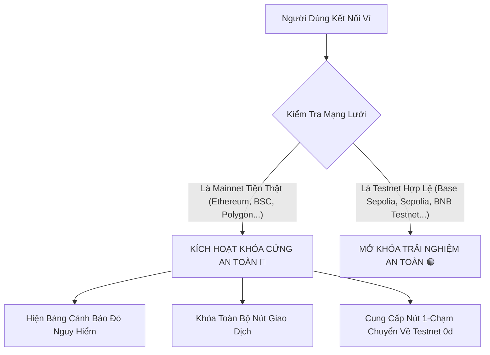

# Chương 3: Trung Tâm Đa Chuỗi Thử Nghiệm (Multi-Chain Testnet Hub)

## 3.1. Phân biệt Mainnet và Testnet
- **Mainnet (Mạng chính thức)**: Nơi các đồng coin (như ETH, BNB, MATIC) có giá trị tiền thật trên thị trường tài chính. Mọi thao tác chuyển đổi hay thực thi hợp đồng đều tiêu tốn tiền thật.
- **Testnet (Mạng thử nghiệm)**: Là một bản sao mô phỏng hoàn chỉnh của mạng blockchain chính thức, được duy trì bởi các tổ chức công nghệ hàng đầu thế giới dành riêng cho nghiên cứu, học tập và kiểm thử phần mềm.
- **Giá trị kinh tế của Testnet**: Toàn bộ đồng coin trên Testnet (như SepoliaETH, BaseETH, tBNB, MATIC Testnet) có **giá trị tài chính bằng đúng 0đ**. Không một ai có thể mua bán hay đổi chúng lấy tiền thật ngoài đời.

> [!NOTE]
> Nhờ có môi trường Testnet, bạn có thể thỏa sức bấm thử các nút giao dịch, đúc hộ chiếu cây, thử nghiệm gửi hạt giống sinh lời hoặc bỏ phiếu quản trị mà **hoàn toàn không lo sợ mất tiền hay bấm nhầm**.

---

## 3.2. Lá Chắn Bảo Vệ: Cơ Chế Khóa Cứng An Toàn Mainnet (Mainnet Safety Lockout)
Để đảm bảo an toàn tuyệt đối cho người học, hệ thống Yêu Trồng Cây tích hợp bộ lọc nhận diện chuỗi tự động (`isMainnetDanger`):

Nếu chiếc ví của bạn vô tình đang kết nối với Ethereum Mainnet, BSC Mainnet, Polygon Mainnet hay Arbitrum One:
1. Giao diện lập tức hiển thị **Cảnh báo màu đỏ nổi bật**: *"Phát hiện mạng Mainnet có rủi ro tài chính"*.
2. Toàn bộ các nút giao dịch trên trang web sẽ bị vô hiệu hóa để **bảo vệ tài sản thật trong ví của bạn**.
3. Bạn chỉ cần nhấn nút **"Chuyển Sang Mạng Thử Nghiệm 0đ"** là hệ thống sẽ tự động chuyển ví về môi trường an toàn.

---

## 3.3. Trung Tâm 5 Chuỗi Testnet Hàng Đầu Thế Giới (Multi-Chain Testnet Hub)
Hệ thống Yêu Trồng Cây hỗ trợ đồng thời 5 mạng chuỗi khối thử nghiệm tiên tiến nhất hiện nay:

| Tên Mạng Thử Nghiệm | Loại Chuỗi | Chain ID (Hex / Dec) | Tiền Tệ Gas Testnet | Trình Khám Phá (Explorer) |
|---|---|---|---|---|
| **Base Sepolia** | Layer 2 Rollup (Coinbase) | `0x14a34` (84532) | BaseETH | [sepolia.basescan.org](https://sepolia.basescan.org) |
| **Ethereum Sepolia** | Layer 1 EVM Cốt lõi | `0xaa36a7` (11155111) | SepoliaETH | [sepolia.etherscan.io](https://sepolia.etherscan.io) |
| **BNB Smart Chain Testnet** | BNB Ecosystem | `0x61` (97) | tBNB | [testnet.bscscan.com](https://testnet.bscscan.com) |
| **Polygon Amoy** | Polygon PoS | `0x13882` (80002) | MATIC (Testnet) | [amoy.polygonscan.com](https://amoy.polygonscan.com) |
| **Arbitrum Sepolia** | Layer 2 Nitro Rollup | `0x66eee` (421614) | ArbETH | [sepolia.arbiscan.io](https://sepolia.arbiscan.io) |

### Đặc tính từng mạng:
1. **Base Sepolia (Khuyến nghị cho Nông nghiệp Đô thị):**  
   Được phát triển bởi Coinbase, mạng này có tốc độ xử lý block chỉ mất 1-2 giây và phí gas cực thấp. Đây là mạng mặc định tối ưu nhất để cấp Hộ chiếu thực vật số.
2. **Ethereum Sepolia:**  
   Mạng thử nghiệm chuẩn mực toàn cầu của Quỹ Ethereum Foundation, dùng để kiểm thử các Smart Contract phức tạp.
3. **BNB Smart Chain Testnet:**  
   Thân thiện với cộng đồng người dùng Binance tại Việt Nam và Đông Nam Á.
4. **Polygon Amoy Testnet:**  
   Hạ tầng thử nghiệm mới nhất thay thế cho Mumbai Testnet trước đây, vận hành trên nền tảng Polygon PoS.
5. **Arbitrum Sepolia:**  
   Công nghệ Optimistic Rollup thế hệ mới với hiệu năng xử lý hàng ngàn giao dịch/giây.

---

## 3.4. Hướng dẫn Thêm và Chuyển Đổi Mạng Chỉ Với 1-Click
Bạn không cần phải tìm kiếm và gõ các thông số kỹ thuật (RPC URL, Chain ID, Biểu tượng tiền tệ) một cách thủ công dễ sai sót:
1. Mở trang Vườn Ươm Web3 Sandbox: `https://yeutrongcay.com/web3-sandbox`.
2. Kết nối chiếc ví cá nhân của bạn.
3. Tại thanh chuyển đổi chuỗi thử nghiệm (**Testnet Hub Switcher**), bạn chỉ cần click vào biểu tượng mạng mong muốn (ví dụ: *Base Sepolia* hoặc *BNB Testnet*).
4. Ví MetaMask sẽ tự động hiện thông báo hỏi:  
   *"Cho phép trang web này chuyển đổi mạng lưới (hoặc thêm mạng mới)?"*
5. Bạn nhấn **Phê duyệt (Approve / Switch Network)** là chiếc ví của bạn đã được cấu hình hoàn chỉnh ngay tức khắc!
