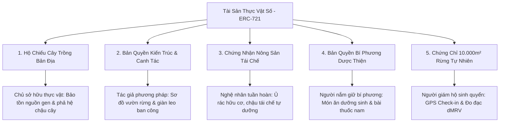

# Chương 5: Hộ Chiếu Thực Vật Số (Plant Passport), Dynamic NFT & GPS Check-in

## 5.1. Căn Cước Công Dân Số Cho Thực Vật (Digital Plant Passport)
Khi nuôi một chú thú cưng thuần chủng, bạn có sổ tiêm phòng và giấy chứng nhận phả hệ. Hộ chiếu thực vật số của Yêu Trồng Cây mang sứ mệnh tương tự cho giới thực vật:
- **Định danh duy nhất**: Mỗi cá thể cây được gán một mã định danh **Token ID** độc nhất trên chuỗi khối.
- **Chứng nhận quyền sở hữu**: Quyền sở hữu cây gắn liền với địa chỉ ví cá nhân của chủ vườn.
- **Tính bất biến**: Lịch sử nguồn gốc, ngày gieo hạt, giống mẹ và vùng sinh thái được bảo chứng vĩnh viễn trên sổ cái.

---

## 5.2. Hệ Thống 5 Phân Lớp Tài Sản Thực Vật Số (NFT Asset Classes)
Hệ sinh thái Yêu Trồng Cây thiết kế 5 phân lớp tài sản chuyên biệt, gắn liền với vai trò và huy hiệu danh dự của từng người làm vườn:

1. **Hộ Chiếu Cây Trồng Bản Địa (Botanical Plant Passport):**  
   - *Vai trò chủ sở hữu:* **Chủ sở hữu thực vật (Botanical Owner)**.
   - *Phạm vi:* Dành cho từng chậu cây cụ thể (Cây ăn trái lùn, thảo dược, hoa cảnh ban công). Gắn liền với nhật ký chăm sóc, nguồn gen gốc và phả hệ cây lớn lên theo thời gian.
2. **Bản Quyền Kiến Trúc & Phương Pháp Canh Tác (Green Architecture & Method Blueprint):**  
   - *Vai trò tác giả:* **Tác giả phương pháp (Green Architect / Permaculturist)**.
   - *Phạm vi:* Xác thực bản quyền các sơ đồ bố trí không gian xanh ban công hẹp, hệ thống tưới nhỏ giọt năng lượng mặt trời, hoặc mô hình vườn rừng 7 tầng tán.
3. **Chứng Nhận Nông Sản Tái Chế & Kinh Tế Tuần Hoàn (Upcycled & Circular Economy Certificate):**  
   - *Vai trò nghệ nhân:* **Nghệ nhân kinh tế tuần hoàn (Circular Artisan)**.
   - *Phạm vi:* Số hóa các sáng kiến tái chế rác nhà bếp thành phân vi sinh IMO/Bokashi, chậu trồng cây từ vỏ dừa ép, men vi sinh bản địa.
4. **Bản Quyền Bí Phương Dược Thiện & Dưỡng Sinh (Healing Culinary & Master Formula):**  
   - *Vai trò nghệ nhân:* **Người nắm giữ bí phương (Master Herbalist)**.
   - *Phạm vi:* Chứng nhận bản quyền các công thức ẩm thực trị liệu, trà thảo mộc dưỡng sinh, rượu ngâm sâm nam chuẩn hóa theo Y học cổ truyền.
5. **Chứng Chỉ Bảo Tồn 10.000m² Rừng Tự Nhiên (10,000m² Natural Forest Conservation - dMRV):**  
   - *Vai trò người giám hộ:* **Người giám hộ sinh quyển (Forest Steward)**.
   - *Phạm vi:* Gắn liền với từng lô rừng 1 hecta (10.000m²) tại các Vườn Quốc Gia. Yêu cầu bắt buộc phải có **Xác thực GPS Check-in thực địa** và đo đạc trữ lượng carbon (dMRV).

---

## 5.3. Công Nghệ Định Vị GPS Check-in Tại Vườn Quốc Gia
Đối với phân lớp Rừng Đặc Dụng, để ngăn ngừa việc tạo lập dữ liệu khống, hệ thống ứng dụng **Cơ chế Xác thực Tọa độ GPS Thực Địa (Proof of Physical Presence)**:
- Hệ thống thiết lập sẵn tọa độ tâm và bán kính kiểm tra của các Vườn Quốc Gia tiêu biểu (Vườn Quốc Gia Cúc Phương - Ninh Bình, Vườn Quốc Gia U Minh Hạ - Cà Mau, Vườn Quốc Gia Bạch Mã - Thừa Thiên Huế).
- Khi người kiểm lâm hoặc tình nguyện viên có mặt tại hiện trường, thiết bị di động sẽ lấy tọa độ GPS thực tế.
- Thuật toán **Công thức Haversine** đo đạc khoảng cách giữa tọa độ của bạn và tọa độ lõi rừng:
  $$d = 2r \arcsin\left(\sqrt{\sin^2\left(\frac{\Delta \varphi}{2}\right) + \cos(\varphi_1)\cos(\varphi_2)\sin^2\left(\frac{\Delta \lambda}{2}\right)}\right)$$
- Chỉ khi bạn thực sự có mặt trong bán kính khu vực bảo tồn, hệ thống mới cấp Thẻ Thông Hành Rừng (Forest GPS Pass) để tiến hành đúc Hộ Chiếu Rừng.

---

## 5.4. Dynamic NFT: Cập Nhật Tiến Trình Cây Lớn Lên Theo Thời Gian
Khác biệt hoàn toàn với các loại NFT tĩnh (chỉ là bức tranh chụp một lần), Hộ chiếu thực vật Yêu Trồng Cây là **Dynamic NFT (NFT Động)**:
- **Giai đoạn 1 (Gieo mầm / Cành giâm):** Ghi nhận ngày ươm và nguồn gen gốc.
- **Giai đoạn 2 (Sinh trưởng & Phân cành):** Sau 6-12 tháng, chủ vườn cập nhật ảnh chụp thực tế và chiều cao tán lá.
- **Giai đoạn 3 (Thu hoạch / Trổ hoa / Cây cổ thụ):** Ghi nhận năng suất quả ngọt hoặc dược tính đạt chuẩn.

Hợp đồng thông minh `PlantPassportERC721.sol` cung cấp hàm `recordGrowthMilestone` cho phép ghi nhận trực tiếp từng cột mốc này lên chuỗi khối mà **vẫn giữ nguyên Token ID gốc của cây**.

---

## 5.5. Dấu Vân Tay Số SHA-256 & Ký Số Mật Mã Học
Trước khi đúc lên chuỗi, toàn bộ hồ sơ của cây (Tên loài + Ngày trồng + Tọa độ + Địa chỉ ví chủ nhân) được đưa qua thuật toán băm **SHA-256**:
- Thuật toán tạo ra một chuỗi mã băm 64 ký tự duy nhất đóng vai trò như dấu vân tay số của chậu cây.
- Chủ vườn sử dụng ví cá nhân (MetaMask) thực hiện lệnh ký số chuẩn **EIP-191**.
- Bạn không mất bất kỳ đồng tiền nào (0đ phí gas trên môi trường thử nghiệm).
- Sau khi đúc thành công, bạn được cấp một **Mã Hộ Chiếu Tra Cứu**, thẻ căn cước có mã QR để in gắn lên chậu cây, và được **thưởng ngay +25 Trái Tim Yêu Vườn ❤️**!
