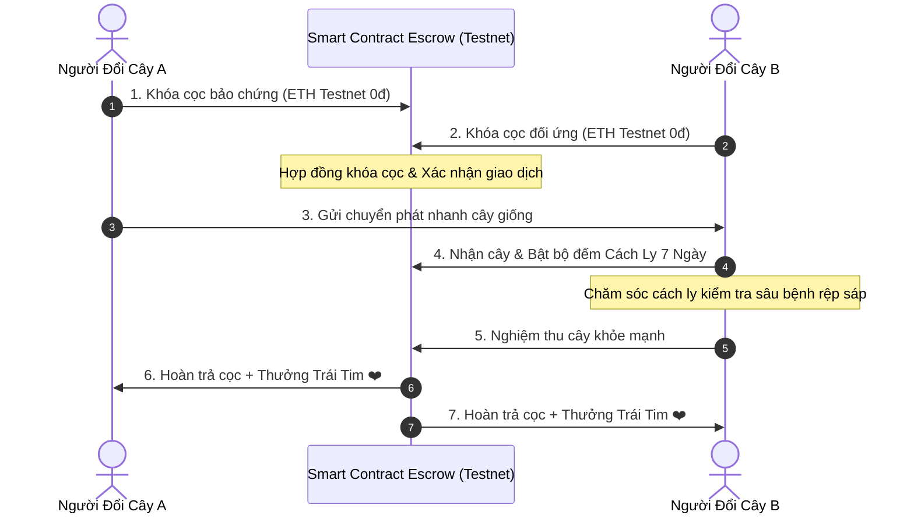

# Chương 6: Smart Contract Escrow - Giao Lưu Cây Giống An Toàn 0đ

## 6.1. Rủi Ro Thường Gặp Khi Đổi Cây Giống Trên Mạng
Cộng đồng người yêu cây rất thích giao lưu, chia sẻ nhánh giâm hoặc trao đổi giống rau thơm, cây ăn trái qua các hội nhóm mạng xã hội. Tuy nhiên, các rủi ro thường trực bao gồm:
1. **Bùng kèo (Gửi một chiều)**: Bên A đóng gói gửi cây rất chu đáo, nhưng bên B sau khi nhận cây xong thì chặn tin nhắn, không gửi cây đã hứa trả lại.
2. **Lây lan dịch hại nấm bệnh**: Cây gửi qua đường chuyển phát nhanh bị dập nát, thối rễ, hoặc mang mầm bệnh rệp sáp, nhện đỏ lây lan sang tàn phá cả khu vườn của người nhận.
3. **Mâu thuẫn không người phân giải**: Không có bên trung gian nào đứng ra giải quyết tranh chấp một cách khách quan.

---

## 6.2. Hợp Đồng Thông Minh Escrow Hoạt Động Ra Sao?
Smart Contract Escrow đóng vai trò như một **két sắt ký quỹ tự động và vị trọng tài công tâm bằng code**:

### Quy trình 3 bước khép kín:
1. **Bước 1 (Khóa cọc bảo chứng)**: Hai bên dùng ví cá nhân ký gửi một khoản cọc tượng trưng vào hợp đồng thông minh. Toàn bộ tiền cọc là **tiền thử nghiệm Testnet (0đ tiền thật)** nhằm rèn luyện thói quen trách nhiệm.
2. **Bước 2 (Giao vận & Kích hoạt 7 Ngày Cách Ly Sinh Học)**:
   - Khi bưu tá giao cây đến tay người nhận, người nhận bấm xác nhận đã nhận kiện hàng.
   - Hợp đồng lập tức kích hoạt bộ đếm ngược **Thời gian cách ly 7 ngày (7-Day Bio-Quarantine)**.
   - Trong 7 ngày này, người nhận đặt chậu cây tại khu vực cách ly, tưới nước theo dõi xem cây có bị nấm rễ, rệp sáp hay héo khô không.
3. **Bước 3 (Nghiệm thu & Giải phóng cọc)**:
   - Nếu cây phục hồi xanh tốt, người nhận bấm **"Nghiệm thu cây khỏe"**.
   - Smart Contract tự động giải ngân hoàn trả 100% tiền cọc cho cả hai người làm vườn, đồng thời **thưởng ngay +15 Trái Tim Yêu Vườn ❤️** cho mỗi bên.
   - Nếu cây bị chết hoặc sai giống, người nhận có quyền bấm nút khiếu nại để hoàn trả cọc mà không bị mất tiền.

---

## 6.3. An Toàn Tuyệt Đối Nhờ Môi Trường Testnet 0đ
Để bảo vệ an toàn tài chính tuyệt đối cho cộng đồng người làm vườn:
* Toàn bộ khoản tiền cọc bảo chứng và phí thực thi hợp đồng thông minh được thực hiện bằng **ETH Testnet (Base Sepolia, Ethereum Sepolia, BNB Testnet...)** được cấp miễn phí từ các vòi Faucet quốc tế.
* Người dùng **hoàn toàn không nạp bất kỳ đồng tiền thật nào**, không có rủi ro mất mát tài chính.
* Mục tiêu tối thượng là giúp người yêu cây làm chủ thao tác ký số và trải nghiệm sức mạnh tự động hóa của hợp đồng thông minh một cách an tâm nhất.

---

## 6.4. Tích Lũy Điểm Trái Tim Yêu Vườn (Hearts ❤️)
Mỗi giao dịch Escrow hoàn thành trung thực là một minh chứng cho sự tử tế của bạn trong cộng đồng. Điểm Trái Tim ❤️ tích lũy được sẽ:
* Nâng hạng hồ sơ nhà vườn từ **Mầm Non** lên **Vườn Ban Công Tiêu Biểu** và **Vườn Ươm Bản Địa Uy Tín**.
* Gia tăng độ tin cậy để các thành viên khác sẵn sàng chia sẻ những nhánh giống quý hiếm cho bạn trong tương lai.
