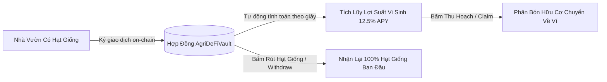

# Chương 8: Vườn Ươm Agri-DeFi & ReFi Sinh Thái (Staking, Carbon & DAO)

## 8.1. DeFi và ReFi Là Gì Trong Nông Nghiệp & Lâm Nghiệp?
- **DeFi (Decentralized Finance - Tài chính Phi tập trung)**: Loại bỏ các khâu trung gian tài chính cồng kềnh (ngân hàng, tổ chức tín dụng) bằng cách sử dụng các hợp đồng thông minh tự động hóa, minh bạch và không thể bị chi phối bởi lợi ích nhóm.
- **ReFi (Regenerative Finance - Tài chính Tái tạo Sinh thái)**: Là một bước tiến nhân văn hơn của DeFi, hướng dòng vốn và nỗ lực cộng đồng vào việc tái tạo thiên nhiên: trồng cây gây rừng, bảo vệ đa dạng sinh học và giảm thiểu biến đổi khí hậu thay vì các hoạt động đầu cơ tài chính vô nghĩa.

> [!IMPORTANT]
> Toàn bộ Vườn Ươm Agri-DeFi trên Yêu Trồng Cây được vận hành **100% trên Mạng Thử Nghiệm (Testnet)** với chi phí **0đ tiền thật**. Mọi tương tác đều kích hoạt giao dịch on-chain thật tới Smart Contract `AgriDeFiVault.sol`, giúp bạn tích lũy kinh nghiệm thực tế về Web3 một cách an toàn nhất!

---

## 8.2. Kho Gửi Hạt Giống Sinh Lời (Seed Staking Vault - APY 12.5%/Năm)
Trong nông nghiệp truyền thống, người nông dân cất trữ hạt giống trong kho để dành cho vụ sau. Trong Web3 nông nghiệp, bạn có thể gửi hạt giống thuần chủng vào **Kho Gửi Hạt Giống (Staking Vault)** để nhận lợi suất phân bón hữu cơ vi sinh:



### Cách tính toán lợi suất tự động của Smart Contract:
Lợi suất được tích lũy theo từng giây trôi qua dựa trên công thức toán học cài đặt trong hợp đồng:
$$\text{Yield} = \frac{\text{Số hạt giống stake} \times \text{APY (1250 bps)} \times \Delta t}{\text{31,536,000 giây (1 năm)}}$$

1. **Gửi Hạt Giống (Stake Seeds)**: Người làm vườn chọn số lượng hạt giống (ví dụ: 100 - 500 hạt) và ký lệnh gửi vào Smart Contract.
2. **Thu Hoạch Lợi Suất (Claim Yield)**: Sau một khoảng thời gian, bạn có thể bấm nút thu hoạch để nhận lượng phân bón vi sinh tích lũy mà không cần rút vốn hạt giống.
3. **Rút Hạt Giống (Withdraw Seeds)**: Bạn có thể rút lại hạt giống bất kỳ lúc nào mà không bị phạt cọc hay giam vốn.

---

## 8.3. Tài Chính Tái Tạo (ReFi) & Hủy Tín Chỉ Carbon Rừng
Mỗi hecta rừng nguyên sinh tại Vườn Quốc Gia Cúc Phương hay Rừng Tràm U Minh Hạ hấp thụ hàng chục tấn khí thải CO₂ mỗi năm:
- **Số hóa Tín chỉ Rừng**: Mỗi phân lớp NFT Rừng Đặc Dụng đại diện cho một khoảng rừng được cộng đồng cam kết chăm sóc và bảo vệ.
- **Cơ chế Hủy (Retire / Burn) Tín chỉ Carbon On-Chain**:
  1. Khi bạn muốn bù trừ lượng khí thải phát sinh từ các chuyến bay hoặc hoạt động sinh hoạt cá nhân, bạn truy cập phân khu ReFi.
  2. Bấm nút **"Hủy Tín Chỉ Carbon On-Chain (Retire Carbon Credit)"**.
  3. Ví MetaMask sẽ thực hiện giao dịch gọi hàm `retireCarbonCredits` trên Smart Contract.
  4. Lượng tín chỉ tương ứng sẽ được "đốt vĩnh viễn" khỏi lưu thông, và hệ thống cấp cho bạn một **Mã Chứng Nhận Sinh Thái (Eco Certificate)** kèm TxHash xác thực trên sổ cái toàn cầu.

---

## 8.4. Quản Trị Phi Tập Trung Cho Nhà Vườn (Gardener DAO Governance)
DAO (Decentralized Autonomous Organization) là mô hình tổ chức không có giám đốc hay hội đồng quản trị tập trung. Mọi quyết định quan trọng đều do các thành viên cộng đồng trực tiếp bỏ phiếu:

```text
[Đề Xuất #04] Tài trợ Quỹ Bảo tồn Nguồn Gen Sâm Đại Hành Bản Địa Tây Nguyên
├── Thời hạn biểu quyết: 14 ngày
├── Tỷ lệ đồng thuận hiện tại: 94.2% Tán thành (Yes) - 5.8% Bác bỏ (No)
├── Hợp đồng xử lý: AgriDeFiVault.sol::voteProposal(proposalId, support)
└── Phần thưởng khi biểu quyết: +15 Trái Tim Yêu Vườn ❤️
```

### Các bước tham gia biểu quyết on-chain:
1. Kết nối ví Web3 tại tab **"5. Agri-DeFi Sandbox"**.
2. Xem danh sách các đề xuất cộng đồng đang mở (như: thành lập trạm ủ rác hữu cơ, nhân giống cây thuốc nam quý).
3. Bấm chọn **"Tán Thành (Yes)"** hoặc **"Bác Bỏ (No)"**.
4. Xác nhận giao dịch trong ví cá nhân. Phiếu bầu của bạn sẽ được đóng dấu thời gian và ghi vĩnh viễn vào khối trên Testnet.
5. Mỗi lá phiếu hợp lệ được tặng ngay **+15 Trái Tim Yêu Vườn ❤️** nhằm tôn vinh tinh thần trách nhiệm xây dựng cộng đồng!
